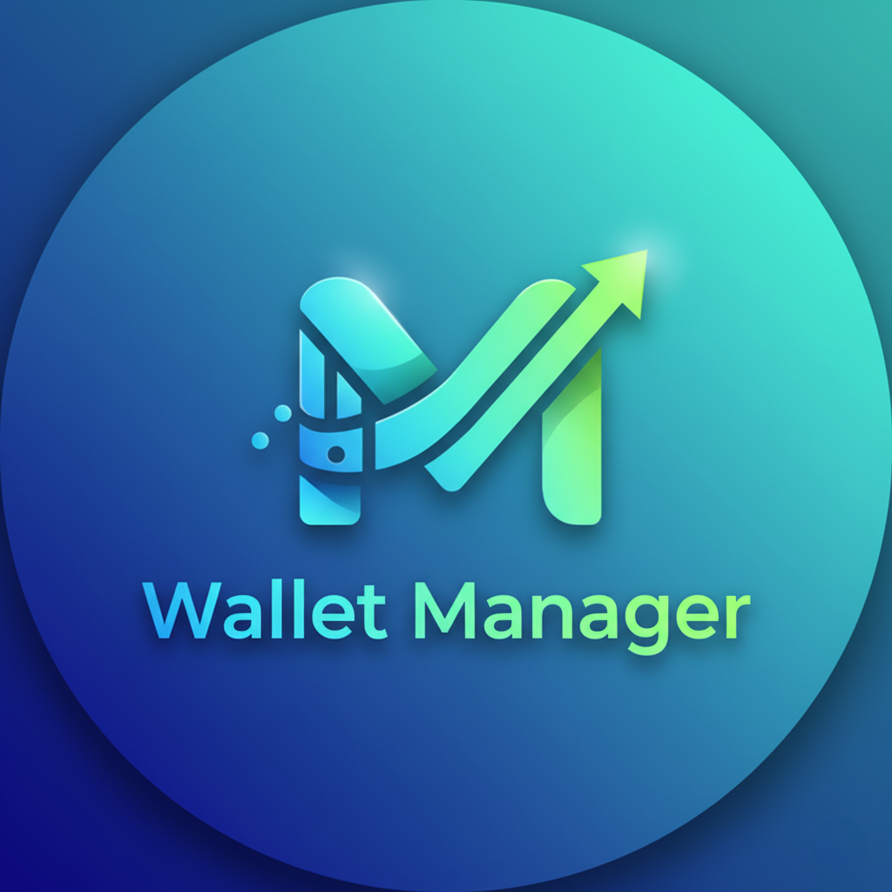
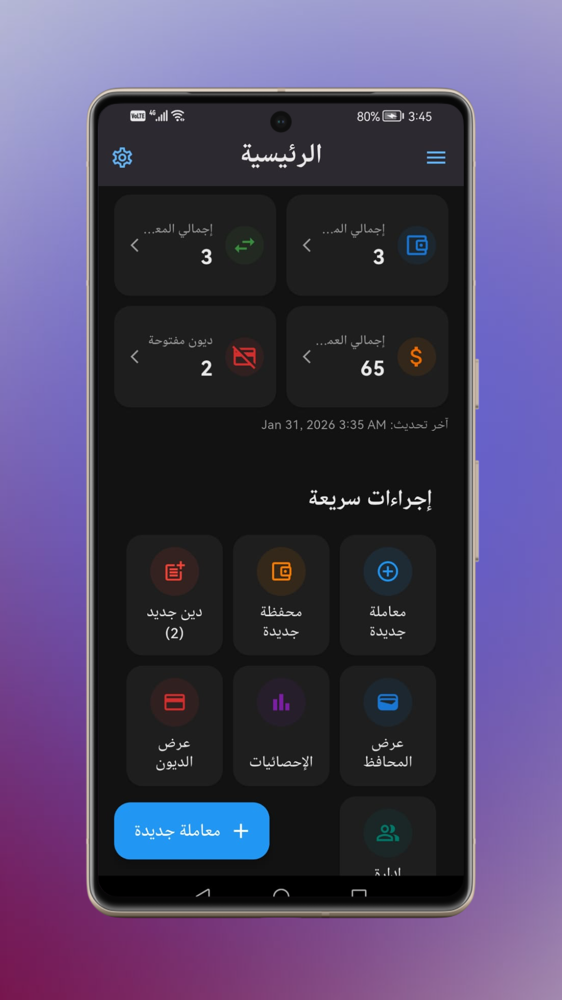
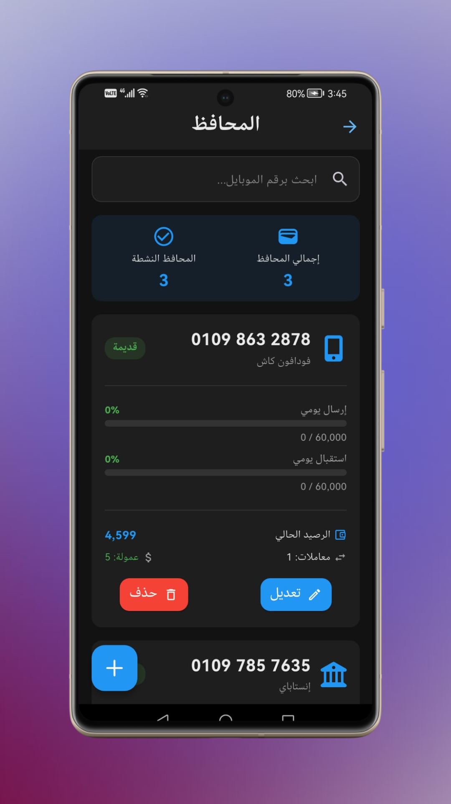
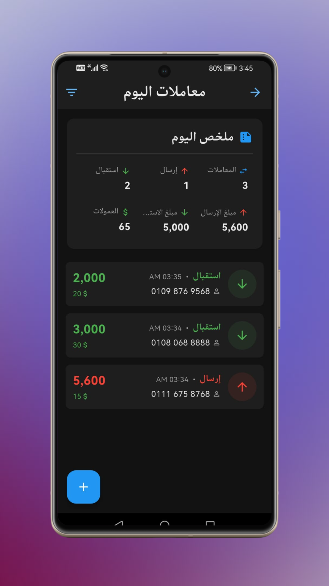
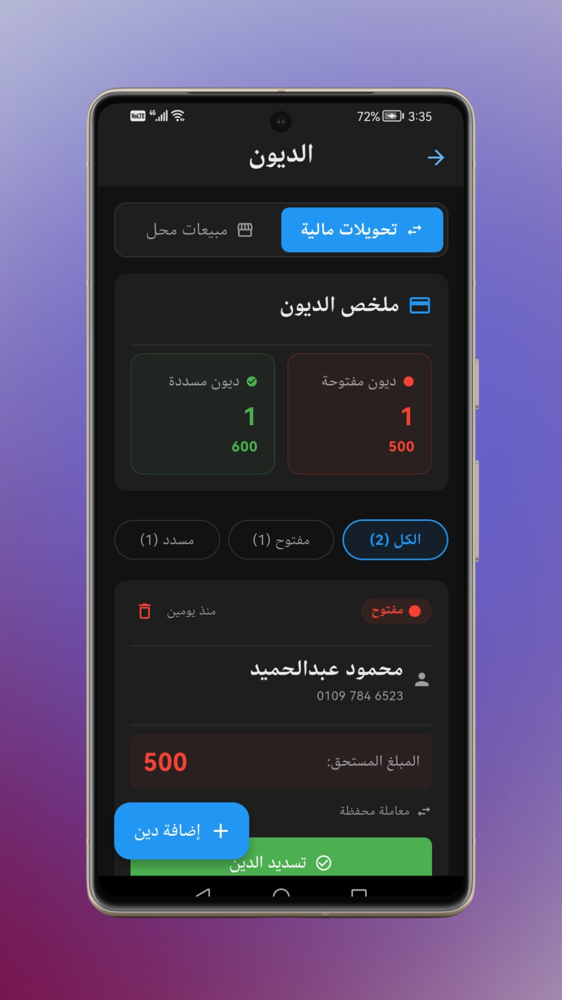
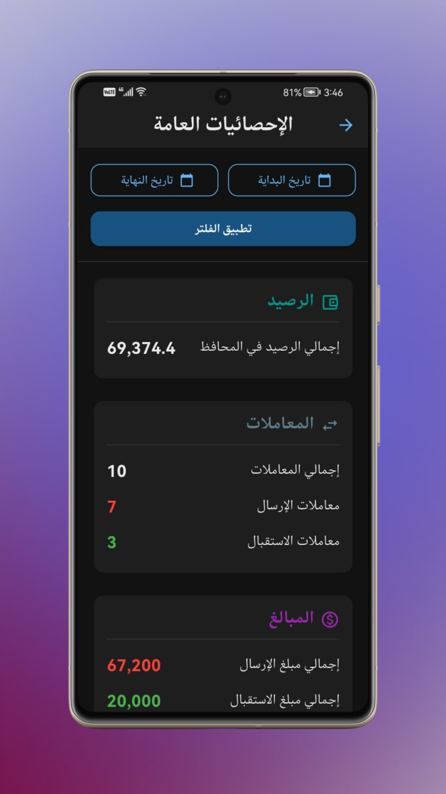
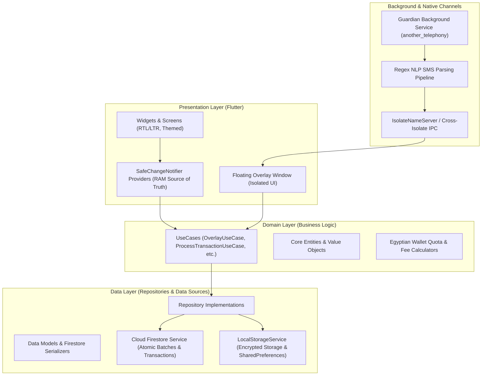
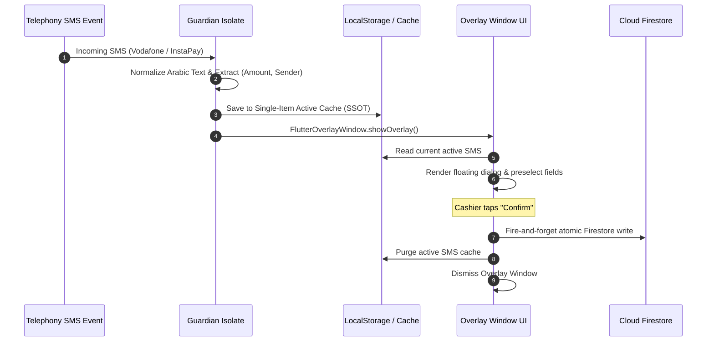

# 📱 Wallet Manager

<p align="center">
  
</p>

<p align="center">
  <b>A Production-Grade, Offline-First Mobile FinTech Solution for Egyptian Merchants</b><br>
  <i>Automate e-wallet transactions via background SMS parsing, native floating overlays, quota tracking, customer debt ledgers, and atomic cloud synchronization.</i>
</p>

<p align="center">
  <a href="https://flutter.dev"></a>
  <a href="https://dart.dev"></a>
  <a href="https://firebase.google.com"></a>
  
  
  <a href="https://github.com/amrloulah-dev/wallet-manager-flutter/releases"></a>
</p>

---

> **💡 نبذة عن المشروع بالعربية:**
> تطبيق مالي احترافي متكامل مبني بفلاتر ومصمم خصيصاً لأصحاب المتاجر ومنافذ الدفع الإلكتروني في مصر لإدارة محافظ الكاش (فودافون كاش، إنستاباي، أورنج كاش، اتصالات كاش، وي باي). يدعم استخراج المعاملات تلقائياً من الرسائل النصية القصيرة (SMS) عبر **Background Isolate** وإظهار نافذة عائمة فورية (**Native Floating Overlay Window**) لتسجيل العمليات وتحديث الأرصدة بضغطة زر دون الحاجة لفتح التطبيق، بالإضافة لدفتر كامل لحسابات الديون، وحساب نسب العمولات، ونظام صلاحيات دقيق للموظفين.

---

## 📑 Table of Contents

- [✨ Key Highlights](#-key-highlights)
- [📸 App Screenshots](#-app-screenshots)
- [🏗️ System Architecture](#️-system-architecture)
- [⚡ Engineering Deep Dive](#-engineering-deep-dive)
  - [1. Background SMS Guardian & Native Floating Overlay](#1-background-sms-guardian--native-floating-overlay)
  - [2. Optimistic UI & RAM-First State Management](#2-optimistic-ui--ram-first-state-management)
  - [3. Egyptian FinTech Quota & Fee Engine](#3-egyptian-fintech-quota--fee-engine)
  - [4. Atomic Cloud Firestore Transactions](#4-atomic-cloud-firestore-transactions)
- [🚀 Core Features](#-core-features)
- [🛠️ Tech Stack & Dependencies](#️-tech-stack--dependencies)
- [💻 Getting Started & Installation](#-getting-started--installation)
- [🧪 Testing & Quality Assurance](#-testing--quality-assurance)
- [👨‍💻 Author & Connect](#-author--connect)

---

## ✨ Key Highlights

- **🤖 Automatic SMS Parsing & Floating Overlay**: Detects incoming transaction SMS notifications in background isolates and immediately triggers a lightweight native floating overlay for 1-tap merchant confirmation.
- **⚡ Optimistic UI with Safe Rollbacks**: Instant RAM mutations with `SafeChangeNotifier`, $O(1)$ lookup maps, and automatic rollback on network anomalies.
- **🛡️ Egyptian E-Wallet Rules Engine**: Specialized quota tracking (daily and monthly limits) and automated tiered commission calculations for Vodafone Cash, InstaPay, Orange Cash, Etisalat Cash, and WE Pay.
- **📒 Customer Debt Ledger (دفتر الديون)**: Track open balances, partial installments, customer contact history, and settlement receipts.
- **🔒 Granular Multi-Tenant Access Control**: Owner accounts with Google/Email sign-in, plus high-security Cashier/Employee PIN accounts with restricted permissions.
- **🌐 Localization & Theming**: Complete bidirectional support for Arabic (RTL with Unicode LTR phone-number safeguards) and English, supporting Light and Dark modes.

---

## 📸 App Screenshots

<table align="center">
  <tr>
    <td align="center" width="20%">
      <b>Dashboard</b><br><br>
      
    </td>
    <td align="center" width="20%">
      <b>Wallets & Limits</b><br><br>
      
    </td>
    <td align="center" width="20%">
      <b>Transactions</b><br><br>
      
    </td>
    <td align="center" width="20%">
      <b>Customer Debts</b><br><br>
      
    </td>
    <td align="center" width="20%">
      <b>Analytics & Stats</b><br><br>
      
    </td>
  </tr>
  <tr>
    <td align="center"><i>Live liquidity & quick actions</i></td>
    <td align="center"><i>Quotas, balances & limits</i></td>
    <td align="center"><i>Send/Receive transaction log</i></td>
    <td align="center"><i>Debt tracking & installments</i></td>
    <td align="center"><i>Financial charts & commissions</i></td>
  </tr>
</table>

---

## 🏗️ System Architecture

Wallet Manager strictly enforces **Clean Architecture** principles to separate concerns, improve testability, and isolate platform-specific native hooks.



### Folder Structure Overview

```text
lib/
├── core/               # Shared utilities, DI (GetIt), AppTheme, ErrorHandler, L10n helpers
├── domain/             # Pure Dart UseCases, Entities, Business Rules & Contracts
├── data/               # Models, Repository implementations, Data Sources & Local Storage
├── presentation/       # UI Screens, Reusable Widgets, Dialogs & Overlay UI Entrypoints
├── providers/          # State Management extending SafeChangeNotifier
└── routes/             # App navigation routing & navigation services
```

---

## ⚡ Engineering Deep Dive

### 1. Background SMS Guardian & Native Floating Overlay

Egyptian payment providers (Vodafone Cash, InstaPay, Orange Cash, etc.) notify merchants via SMS upon money transfers. Wallet Manager listens to these SMS events seamlessly:

1. **Independent Background Isolate (`Guardian Isolate`)**: Operates continuously using `flutter_background_service` and `another_telephony`.
2. **Robust Multi-lingual NLP Extraction**: Strict anchor-based regex extracts amounts (handling Arabic/Hindi digits `٠-٩` and fractional decimal normalization) and extracts counterparties (prefixed mobile numbers `01[0125]\d{8}` or IPN/Bank handles).
3. **Native Window Orchestration**: Boots `flutter_overlay_window` with `@pragma("vm:entry-point") overlayMain()`. The floating window renders on top of POS/payment apps, pre-populating fields and requesting instant focus so the cashier can assign the transaction in 1 tap.



### 2. Optimistic UI & RAM-First State Management

To deliver instantaneous UI response in unreliable network environments:
- **`SafeChangeNotifier` Base Class**: Microtask-debounced dispatching prevents "rebuild during build" Flutter crashes and tracks disposal state.
- **$O(1)$ Hash Maps**: Providers store entities in `Map<String, Model>` indexed by IDs instead of linear lists.
- **Atomic Rollbacks**: Every optimistic mutation stores pre-state snapshot. If a background Firestore commit fails, the provider automatically reverts RAM state, alerts the user, and triggers a safe re-render.
- **Fetch Shield**: Automatically suppresses background auto-sync for 5 seconds post-injection to prevent overwriting fresh local changes with stale server snapshots.

### 3. Egyptian FinTech Quota & Fee Engine

- **Provider-Aware Quota Monitoring**: Enforces strict daily and monthly transaction limits per Egyptian Central Bank guidelines for each registered line.
- **Automated Service Fee Calculus**: Dynamic fee logic calculates tier-based fees, percentage deductions, or flat operational costs automatically, ensuring RAM financial parity between `WalletProvider` and `StatisticsProvider`.

### 4. Atomic Cloud Firestore Transactions

All multi-document mutations (e.g., executing a transaction that modifies a wallet balance, updates store statistics, and increments customer debt) run inside `_firestore.runTransaction` blocks:
- **Read-Before-Write Compliance**: Strict adherence to Firestore transaction rules where all queries and document reads precede any mutation calls.
- **Atomic Aggregation Counters**: Daily and total financial metrics utilize `FieldValue.increment(delta)` to prevent race conditions during high-volume cashier usage.

---

## 🚀 Core Features

| Feature | Description |
| :--- | :--- |
| **👛 Multi-Wallet Hub** | Track Vodafone Cash, InstaPay, Orange Cash, Etisalat Cash, and WE Pay balances and limit quotas in real time. |
| **⚡ Instant Transactions** | Fast recording of Send / Receive transfers with automatic commission calculation and instant balance deduction. |
| **📖 Debt Ledger (دفتر الديون)** | Manage credit accounts for clients, register partial settlements, and monitor customer debts linked directly to transactions. |
| **👥 Dual-Tier Access Control** | Dedicated Store Owner login alongside PIN-protected Cashier profiles with granular permission toggles. |
| **📊 Advanced Financial Analytics** | Real-time statistics tracking net volume, daily profits, commission earnings, and historical date range filtering. |
| **🌐 Full Arabic & English Support** | Native RTL layouts with localized Arabic numerals and Unicode LTR guarding (`\u200E`) to eliminate reversed phone numbers. |
| **🌓 Dynamic Theming** | System-adaptive Light and Dark modes built with dynamic `AppColors` tokens. |

---

## 🛠️ Tech Stack & Dependencies

- **Core Framework:** [Flutter](https://flutter.dev) (Dart 3.x)
- **Backend & Cloud Services:**
  - Firebase Authentication (Google Sign-In, Email/Password)
  - Cloud Firestore (NoSQL, Atomic Transactions, Offline Persistence)
  - Firebase Analytics, Crashlytics & Performance Monitoring
- **State Management:** `provider` (Scoped `Selector`, `ChangeNotifierProxyProvider`, `SafeChangeNotifier`)
- **Native & Background Services:**
  - `flutter_background_service` (Persistent background isolation)
  - `flutter_overlay_window` (System alert floating UI)
  - `another_telephony` (SMS reception & incoming broadcast receiver)
- **Dependency Injection:** `get_it` (Service Locator with idempotency guards)
- **Local Persistence & Security:**
  - `flutter_secure_storage` (Biometric & PIN hardware-backed storage)
  - `shared_preferences` (Fast multi-isolate configuration cache)
  - `cryptography` & `bcrypt` (Secure PIN hashing)
- **Internationalization:** `flutter_localizations`, `intl` (AR/EN `.arb` translation architecture)

---

## 💻 Getting Started & Installation

### Prerequisites

- [Flutter SDK](https://flutter.dev/docs/get-started/install) (`>= 3.0.0`)
- [Android Studio](https://developer.android.com/studio) or VS Code
- Android Device running Android 8.0+ (Required for testing SMS permissions & native overlay features)
- A configured [Firebase Project](https://console.firebase.google.com/)

### Local Setup

1. **Clone the repository:**
   ```bash
   git clone https://github.com/amrloulah-dev/wallet-manager-flutter.git
   cd wallet-manager-flutter
   ```

2. **Install dependencies:**
   ```bash
   flutter pub get
   ```

3. **Configure Firebase:**
   - Place your `google-services.json` inside `android/app/`.
   - Place your `GoogleService-Info.plist` inside `ios/Runner/` (if targeting iOS).

4. **Generate localization files:**
   ```bash
   flutter gen-l10n
   ```

5. **Run the application:**
   ```bash
   flutter run
   ```

---

## 🧪 Testing & Quality Assurance

Wallet Manager includes unit tests, widget tests, and repository tests leveraging `mocktail` and `fake_cloud_firestore` to guarantee 100% financial calculation accuracy without requiring live Firebase emulators.

```bash
# Run the entire test suite
flutter test

# Run tests in non-interactive CI mode
CI=true flutter test

# Verify static analysis & code health
flutter analyze

# Format code
dart format .
```

---

## 👨‍💻 Author & Connect

**Amr Loulah**  
*Senior Flutter & Mobile Application Engineer*

<p align="left">
  <a href="https://github.com/amrloulah-dev">
    
  </a>
  <a href="https://linkedin.com/in/amr-loulah">
    
  </a>
  <a href="mailto:amrloulah@gmail.com">
    
  </a>
</p>

> 🤝 **Open to Opportunities & Collaborations:**  
> Feel free to explore the repository, open an issue, submit a pull request, or reach out for mobile engineering roles and FinTech consulting!

---

<p align="center">
  <sub>Built with ❤️ and Dart in Egypt. Licensed under the <a href="LICENSE">MIT License</a>.</sub>
</p>