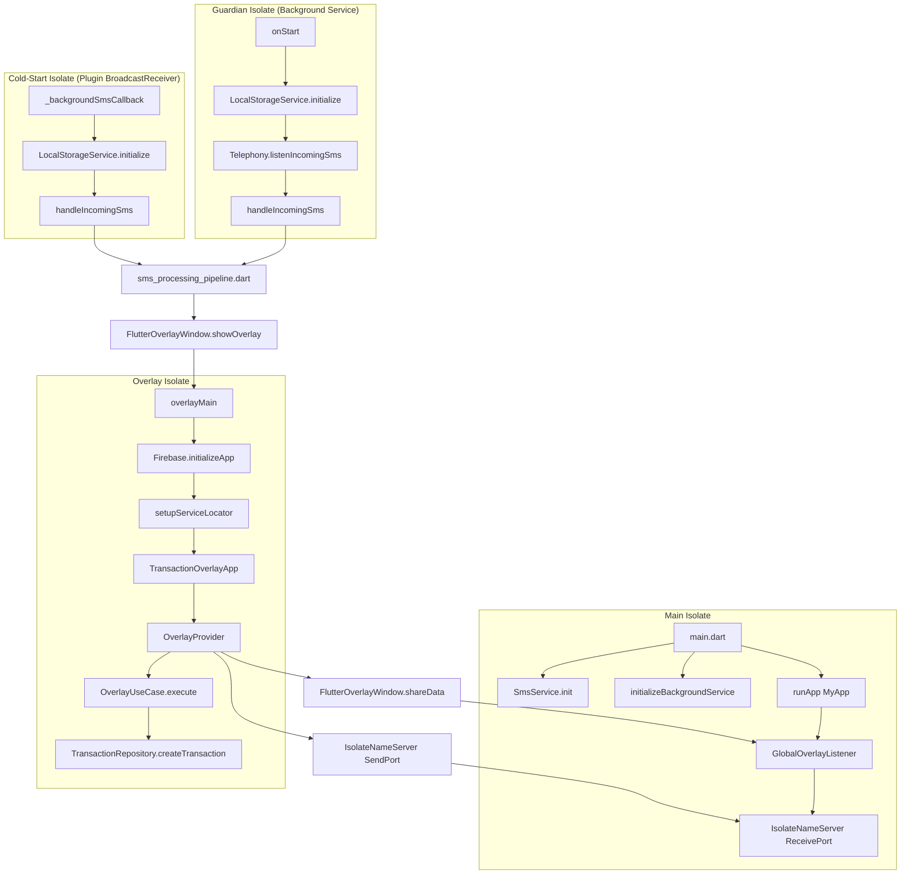
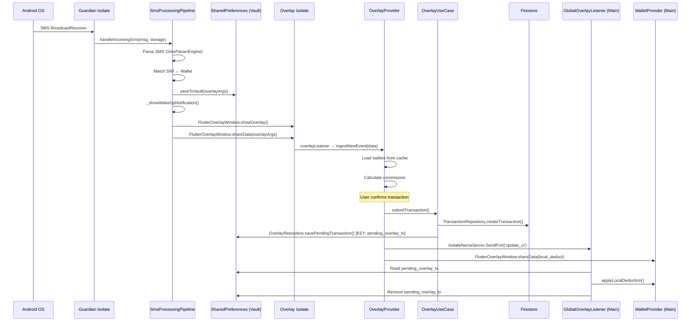
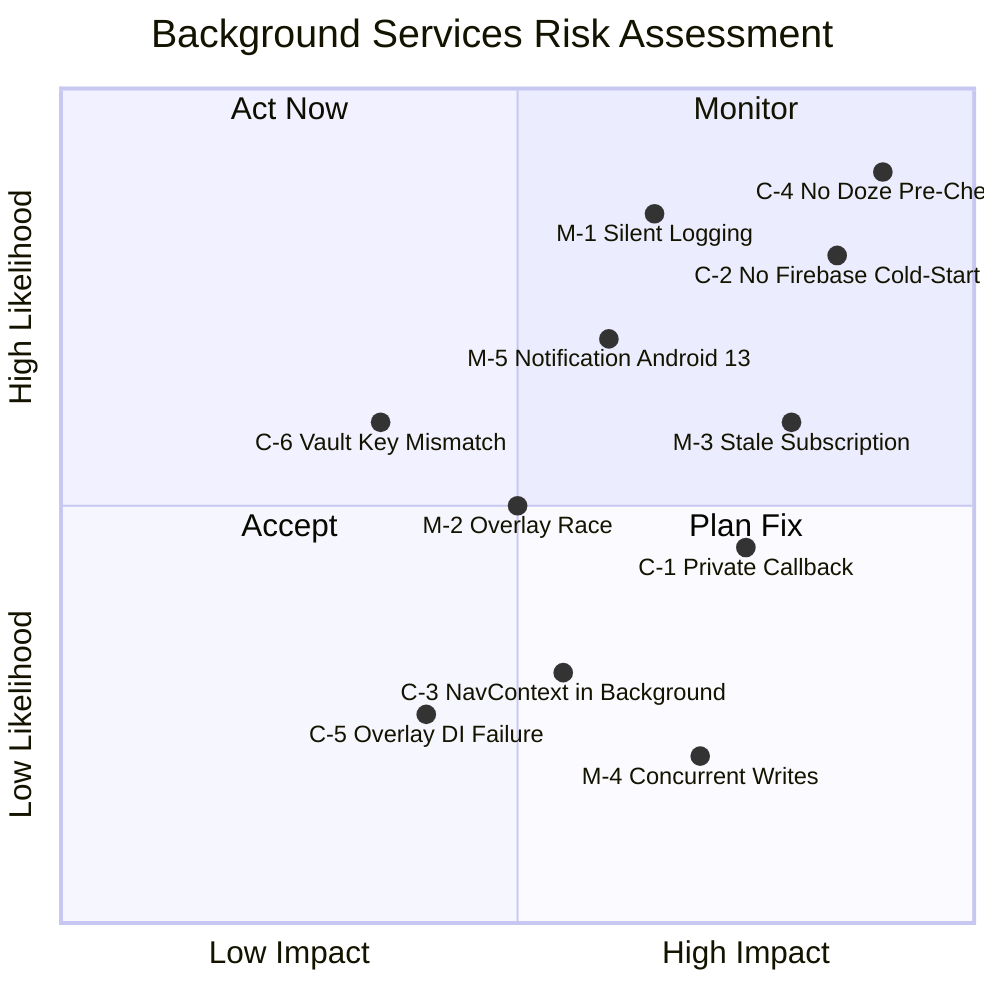

# 📋 Phase 8: Exhaustive Background Services & OS Constraints Audit Report

> **Audit Scope:** All files under `lib/` related to background execution, SMS automation, overlay lifecycle, isolate boundaries, and OS-level constraints (Doze, battery, permissions).
>
> **Mandate:** Zero code modifications. Inspection-only report.
>
> **Date:** 2026-05-05

---

## Architecture Overview

---

## 🔴 TABLE 1: CRITICAL (Isolate Crashes / Race Conditions / OS Kills)

| # | File | Line(s) | Exact Issue / Code Snippet | Why It's Critical |
|---|------|---------|---------------------------|-------------------|
| C-1 | [background_service.dart](file:///c:/src/walletmanager/lib/core/services/background_service.dart#L98-L99) | 98-99 | `@pragma('vm:entry-point')` on `void _backgroundSmsCallback(SmsMessage message)` — the function is **private** (prefixed `_`). | The `another_telephony` plugin's native `BroadcastReceiver` needs to invoke this via reflection / entrypoint registry. **Private top-level functions are valid Dart entrypoints**, but the `_` prefix makes it invisible to code-generation tools and violates the plugin's documented contract which expects a **public** top-level function. Some versions of the plugin and certain Android build modes (R8/ProGuard with aggressive tree-shaking) may fail to locate it, causing **silent SMS drops in production** with zero error feedback. |
| C-2 | [background_service.dart](file:///c:/src/walletmanager/lib/core/services/background_service.dart#L99-L116) | 99-116 | `_backgroundSmsCallback` initializes `LocalStorageService` and calls `handleIncomingSms`, but **never initializes Firebase**. The pipeline calls `AppErrorHandler.logSilentError()` which in release mode calls `FirebaseCrashlytics.instance.recordError()`. | In the cold-start isolate, Firebase is **not initialized**. Any `FirebaseCrashlytics.instance` call will throw a `LateInitializationError` or `FirebaseException("No Firebase App")`, which is caught by the outer `catch(e)` on line 113 — but this means **all error reporting from the cold-start path is silently swallowed**. The background isolate becomes a black box in production. |
| C-3 | [app_error_handler.dart](file:///c:/src/walletmanager/lib/core/errors/app_error_handler.dart#L136) | 136 | `final context = NavigationService.navigatorKey.currentContext;` inside `handle()` | `AppErrorHandler.handle()` is called from `sms_parser_engine.dart` (lines 48, 65) during background SMS parsing. In the Guardian Isolate and cold-start isolate, `NavigationService.navigatorKey` references a `GlobalKey<NavigatorState>` that was **never attached to any widget tree**. While `currentContext` returns `null` safely (the code null-checks it on line 139), the subsequent notification path on line 153 calls `_ensureNotificationsInitialized()` which is **safe** — but the `FlutterOverlayWindow.isActive()` call on line 43 inside the notification tap handler assumes an overlay context exists. **Risk: If the notification tap handler fires in the Guardian Isolate, calling `FlutterOverlayWindow.closeOverlay()` from a headless isolate can crash.** |
| C-4 | [sms_service.dart](file:///c:/src/walletmanager/lib/core/services/sms_service.dart#L58-L68) | 58-68 | Battery optimization is **requested** but denial is only surfaced as a `ToastUtils.showWarning()`. No persistent flag is stored, and the background service starts regardless. | On Android 6+ with Doze mode, if the user denies `ignoreBatteryOptimizations`, the OS will **kill the foreground service** after ~15 minutes of screen-off. The Guardian Isolate dies silently. There is **no pre-flight check** in `initializeBackgroundService()` or `onStart()` to verify battery optimization status. This means **SMS monitoring silently stops** on most OEM-skinned devices (Xiaomi, Huawei, Samsung) without any user feedback. |
| C-5 | [overlay_provider.dart](file:///c:/src/walletmanager/lib/presentation/overlays/overlay_provider.dart#L20) | 20 | `_localStorageService = localStorageService ?? LocalStorageService()` | The `OverlayProvider` is created inside the Overlay Isolate (`overlayMain()`). `LocalStorageService()` returns the singleton `_instance` — but this singleton's `_prefs` was initialized in **this** isolate via `setupServiceLocator()` → `LocalStorageService().initialize()`. However, on line 94, `LocalStorageService.instance.reloadDisk()` is called as a **static** accessor. Since `LocalStorageService` is a singleton with a factory constructor, `instance` and `LocalStorageService()` return the same object. **The risk:** If `setupServiceLocator()` fails (line 122 of main.dart), `_prefs` is null, and line 94 will throw `Exception('Local Storage not initialized...')`, but this is caught on line 133 and surfaced as `_errorMessage = 'Failed to load data: $e'` — the overlay shows a broken state with no retry mechanism. |
| C-6 | [overlay_repository.dart](file:///c:/src/walletmanager/lib/data/repositories/overlay_repository.dart#L5-L8) | 5-8 | `final prefs = await SharedPreferences.getInstance();` creates a **new** SharedPreferences handle each call, bypassing `LocalStorageService`. The vault key `pending_overlay_tx` differs from `LocalStorageService._kPendingOverlayData` (`pending_overlay_data`). | Two separate SharedPreferences keys are used for overlay data: `pending_overlay_tx` (written by `OverlayRepository`) and `pending_overlay_data` (written by `sms_processing_pipeline.dart` via `LocalStorageService.saveToVault()`). The `GlobalOverlayListener._fetchAndApplyData()` reads `pending_overlay_tx` (line 59), while the overlay's `ingestNewEvent()` reads from `FlutterOverlayWindow.overlayListener`. **The vault (`pending_overlay_data`) written by the pipeline is NEVER consumed** — it accumulates stale data indefinitely. This is a **data inconsistency** but not a crash; however, it wastes storage and could confuse debugging. |

---

## 🟡 TABLE 2: MEDIUM (Technical Debt / Reliability Gaps)

| # | File | Line(s) | Exact Issue / Code Snippet | Impact |
|---|------|---------|---------------------------|--------|
| M-1 | [background_service.dart](file:///c:/src/walletmanager/lib/core/services/background_service.dart#L75-L76) | 75-76 | `if (kDebugMode) debugPrint('🛑 [BACKGROUND] SMS automation is disabled...');` | Only `kDebugMode`-guarded `debugPrint` is used for logging inside the Guardian Isolate. In **release builds**, if SMS automation is disabled and the service stops, there is zero telemetry. If the service starts and later encounters errors in `handleIncomingSms`, the catch block on line 113 also uses `debugPrint` behind `kDebugMode`. **All background diagnostics are invisible in production.** |
| M-2 | [sms_processing_pipeline.dart](file:///c:/src/walletmanager/lib/core/services/sms_processing_pipeline.dart#L221-L242) | 221-242 | Overlay show sequence: `isPermissionGranted()` → `isActive()` → `closeOverlay()` → `showOverlay()` → `shareData()`. No retry, no delay between close and show. | On some OEM devices (Xiaomi MIUI, Huawei EMUI), closing and immediately re-opening the overlay window within the same event loop tick causes the new overlay to fail silently. The `shareData()` call on line 242 may fire before the overlay's `overlayListener` is registered, causing the **first SMS event to be lost**. The vault fallback mitigates this partially, but only if the overlay reads from vault on init (which it doesn't — it waits for `overlayListener` events). |
| M-3 | [sms_processing_pipeline.dart](file:///c:/src/walletmanager/lib/core/services/sms_processing_pipeline.dart#L107-L120) | 107-120 | Subscription limits (`subIsSuspended`, `subSmsEnabled`, `subEndDateMs`) are read from `SharedPreferences` which were cached at last main-app session. | If the subscription expires or is suspended **while the app is killed**, the background isolate will use **stale cached limits** until the user opens the app again and the main isolate syncs fresh data via `SubscriptionProvider`. This means the SMS pipeline could continue processing transactions for an expired/suspended subscription for days. **Financial risk: transactions recorded without valid subscription.** |
| M-4 | [overlay_usecase.dart](file:///c:/src/walletmanager/lib/domain/usecases/overlay_usecase.dart#L83) | 83 | `await _transactionRepository.createTransaction(newTransaction);` | The overlay creates a Firestore transaction directly via `TransactionRepository.createTransaction()`. This is the **same atomic write path** used by the main app's `TransactionProvider`. However, if the main app is simultaneously open and the user manually creates a transaction for the same wallet, there is a **theoretical race condition** where both writes succeed but stats are updated non-atomically. The `TransactionRepository` uses `runTransaction` internally which mitigates this, but the **wallet balance update** happens optimistically in RAM (via `local_deduct` shareData) without a Firestore-level compare-and-swap. |
| M-5 | [sms_processing_pipeline.dart](file:///c:/src/walletmanager/lib/core/services/sms_processing_pipeline.dart#L68-L81) | 68-81 | `_showWakeUpNotification` creates a notification with `category: AndroidNotificationCategory.alarm` but the channel is only created at runtime (first SMS). | If the first SMS arrives before the user has ever opened the app (e.g., after a reboot with `autoStartOnBoot: true`), the notification channel is created lazily. On Android 13+, the app needs `POST_NOTIFICATIONS` permission (requested in `sms_service.dart` line 60). But `sms_service.dart.init()` only runs if the **main app opens** and `isSmsAutomationEnabled` is true. **If the main app was never opened after install, the background service starts (autoStart: true) but notifications will be silently blocked on Android 13+.** |

---

## 🟢 TABLE 3: QUICK WINS (Low-Risk Improvements)

| # | File | Line(s) | Exact Issue / Code Snippet | Recommended Fix |
|---|------|---------|---------------------------|-----------------|
| Q-1 | [background_service.dart](file:///c:/src/walletmanager/lib/core/services/background_service.dart#L114) | 114 | `if (kDebugMode) debugPrint('[ERROR] [low] [background_sms_callback] $e');` — inconsistent error format. | Replace with `AppErrorHandler.logSilentError(e.toString(), 'background_sms_callback', stackTrace: StackTrace.current);`. Requires Firebase init in the cold-start path (see C-2). |
| Q-2 | [overlay_repository.dart](file:///c:/src/walletmanager/lib/data/repositories/overlay_repository.dart#L5-L8) | 5-8 | Direct `SharedPreferences.getInstance()` call bypassing `LocalStorageService`. | Inject `LocalStorageService` and use its `saveToVault()` or a dedicated method. Align the key with `LocalStorageService._kPendingOverlayData` or document the intentional key separation. |
| Q-3 | [sms_processing_pipeline.dart](file:///c:/src/walletmanager/lib/core/services/sms_processing_pipeline.dart#L86-L87) | 86-87 | Notification ID `0` — hardcoded. Repeated SMS notifications replace each other. | Use a hash of the transaction data or an incrementing counter stored in `LocalStorageService` to allow multiple pending notifications. |
| Q-4 | [wallet_provider.dart](file:///c:/src/walletmanager/lib/providers/wallet_provider.dart#L105-L106) | 105-106 | `debugPrint('🔥 [TX_FLOW]...')` in overlay listener — verbose in release builds. | Wrap in `if (kDebugMode)` guard. `debugPrint` is a no-op in release for I/O but the string interpolation still executes, wasting CPU cycles. |

---

## 🔬 Deep-Dive Analysis

### 1. Isolate Boundary Integrity

| Component | Isolate | Firebase Init? | UI Context? | Error Reporting | Verdict |
|-----------|---------|---------------|-------------|-----------------|---------|
| `main()` | Main | ✅ Yes | ✅ Yes | Full (Toast + Crashlytics) | ✅ Safe |
| `onStart()` (Guardian) | Background Service | ❌ No | ❌ No | `handleIncomingSms` → `logSilentError` → **Crashlytics fails** | 🔴 Broken |
| `_backgroundSmsCallback()` | Cold-start Plugin | ❌ No | ❌ No | `debugPrint` only (kDebugMode) | 🔴 Blind |
| `overlayMain()` | Overlay | ✅ Yes | ✅ Yes (own MaterialApp) | `OverlayProvider` catch → `_errorMessage` | ✅ Safe |
| `SmsParserEngine.parse()` | Inherited from caller | Inherited | ❌ No | `AppErrorHandler.handle()` → context null check | 🟡 Partial |

### 2. Data Flow: SMS → Firestore Write

### 3. SharedPreferences Key Collision Analysis

| Key | Written By | Read By | Isolate | Purpose |
|-----|-----------|---------|---------|---------|
| `pending_overlay_data` | `sms_processing_pipeline.dart` via `LocalStorageService.saveToVault()` | **Nobody** (orphaned) | Guardian/Cold-start | Vault fallback for overlay args |
| `pending_overlay_tx` | `overlay_repository.dart` via direct `SharedPreferences` | `GlobalOverlayListener._fetchAndApplyData()` | Overlay → Main | Transaction data for main app sync |
| `sms_automation_enabled` | Main app settings | Guardian Isolate, Cold-start, Main | Cross-isolate | Feature gate |
| `sub_end_date_ms` | Main app `SubscriptionProvider` | `sms_processing_pipeline.dart` | Cross-isolate | Subscription expiry check |
| `wallet_lite_cache` | `WalletCacheManager` via `LocalStorageService` | `OverlayProvider.ingestNewEvent()` | Main → Overlay | Wallet list for dropdown |

> [!WARNING]
> The `pending_overlay_data` vault key is **written but never read**. This is dead code that accumulates stale data. Either consume it in the overlay as a fallback for `shareData` failures, or remove the write.

### 4. Android OS Constraint Matrix

| Constraint | Handled? | File | Risk Level |
|-----------|----------|------|------------|
| Doze mode (Battery Optimization) | 🟡 Requested, not enforced | `sms_service.dart:58-68` | 🔴 High — service killed on OEM devices |
| `POST_NOTIFICATIONS` (Android 13+) | 🟡 Requested in `SmsService.init()` only | `sms_service.dart:60` | 🔴 High — notifications blocked if main app not opened |
| `SYSTEM_ALERT_WINDOW` | ✅ Checked before overlay show | `sms_processing_pipeline.dart:221` | ✅ Safe |
| `RECEIVE_SMS` / `READ_SMS` | ✅ Requested in `SmsService.init()` | `sms_service.dart:44` | ✅ Safe |
| Auto-start on boot | ✅ `autoStartOnBoot: true` | `background_service.dart:38` | ✅ Configured |
| Foreground service notification | ✅ Configured | `background_service.dart:40-42` | ✅ Safe |
| Screen wake from sleep | ✅ High-priority notification | `sms_processing_pipeline.dart:65-92` | ✅ Safe |

---

## 📊 Risk Priority Matrix

---

## 🎯 Recommended Remediation Order

1. **C-4** (Doze pre-check) — Highest impact × highest likelihood. Add `PowerManager.isIgnoringBatteryOptimizations` check in `onStart()` and surface result via persistent notification.
2. **C-2** (Firebase in cold-start) — Add `Firebase.initializeApp()` in `_backgroundSmsCallback` before any error reporting.
3. **C-1** (Private callback) — Rename `_backgroundSmsCallback` → `backgroundSmsCallback` (public).
4. **M-1** (Silent logging) — Replace all `debugPrint` in background paths with `AppErrorHandler.logSilentError()` (requires C-2 fix first).
5. **M-3** (Stale subscription) — Add a TTL check: if `sub_end_date_ms` was last synced > 24h ago, force-block SMS processing and show notification asking user to open app.
6. **C-6** (Vault key mismatch) — Consolidate to a single key and single access pattern through `LocalStorageService`.
7. **M-5** (Android 13 notifications) — Request `POST_NOTIFICATIONS` in `onStart()` of the Guardian Isolate as a safety net.

---

## ✅ What's Working Well

| Aspect | Evidence |
|--------|----------|
| **Isolate separation** | The Guardian Isolate (`onStart`) correctly initializes its own `LocalStorageService` (line 65-66) and never imports UI-specific code. |
| **Pipeline reuse** | `sms_processing_pipeline.dart` is correctly shared between foreground and background paths without isolate-specific imports. |
| **Optimistic UI** | `GlobalOverlayListener` + `applyLocalDeduction()` provides zero-Firestore-read local state sync after overlay transactions. |
| **Fetch Shield** | Both `WalletProvider` and `TransactionProvider` implement a 5-second fetch shield to prevent stale Firestore reads from overwriting optimistic mutations. |
| **Overlay lifecycle** | `FlutterOverlayWindow.overlayListener` subscription is properly cancelled in `dispose()` across both `WalletProvider` and `_OverlayContentState`. |
| **Error boundary in pipeline** | The top-level `try/catch` in `handleIncomingSms()` (line 243-250) ensures background isolates never crash from unhandled exceptions. |
| **Cross-isolate communication** | `IsolateNameServer` + `ReceivePort` pattern in `GlobalOverlayListener` is correctly implemented with cleanup in `dispose()`. |

---

> **Report 8 (Background Services & OS Constraints) — COMPLETE.**
> No code was modified during this audit.
