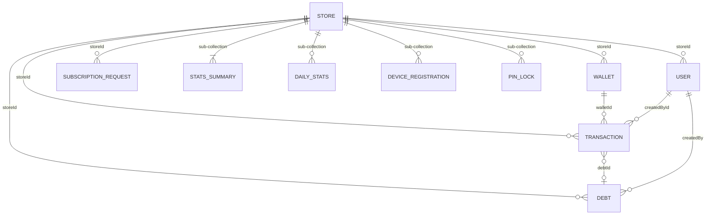

# 🗄️ Report 1: Database Schema & Data Models

> **Generated:** 2026-06-14  
> **Source:** Full codebase audit of `c:\src\walletmanager`  
> **Firebase Project:** `ewallet-manager-421b8`  
> **Firestore Rules:** `firestore.rules` | **Indexes:** `firestore.indexes.json`

---

## 1. Firestore Architecture & Hierarchy

### 1.1 Collection Map

The Firestore database is organized into **8 root-level collections** and **3 sub-collection hierarchies** nested under the `stores` collection. The `storeId` acts as the primary partition key for all tenant-scoped data.

```
firestore-root/
│
├── stores/{storeId}                          # Root: Store profile, subscription, settings, stats
│   ├── stats/summary                         # Sub-doc: Aggregated lifetime statistics
│   ├── daily_stats/{YYYY-MM-DD}              # Sub-collection: Per-day transaction/debt aggregates
│   ├── device_registrations/{deviceId}       # Sub-collection: Per-store device tracking
│   └── pin_locks/{hashedPin}                 # Sub-collection: Atomic employee PIN uniqueness locks
│
├── users/{userId}                            # Root: Owner and employee user accounts
├── wallets/{walletId}                        # Root: Financial wallets (partitioned by storeId field)
├── transactions/{transactionId}              # Root: Individual financial transactions
├── debts/{debtId}                            # Root: Customer debt records
├── subscription_requests/{requestId}         # Root: Subscription upgrade payment requests
├── device_registrations/{deviceId}           # Root: Anti-fraud hardware device tracking
├── license_keys/{keyId}                      # Root: Legacy license key activation records
└── system_configs/default                    # Root: Global system configuration singleton
```

### 1.2 Collection Purposes

| Collection Path | Purpose | Access Pattern |
|---|---|---|
| `stores/{storeId}` | Central store entity containing owner info, subscription tier, settings, and embedded quick stats. Acts as the tenant root. | Owner: full CRUD. Employee: read only. |
| `stores/{storeId}/stats/summary` | Single document holding aggregated lifetime statistics (total wallets, total transactions, total balances, debt counts). Updated atomically via `FieldValue.increment()` on every transaction/wallet/debt mutation. | Read: owner + employees with `viewDashboardStats`. Write: users with `createTransaction`, `createDebt`, or `collectDebt`. |
| `stores/{storeId}/daily_stats/{YYYY-MM-DD}` | Per-day rollup documents. Document ID is the date string (e.g., `2026-06-14`). Tracks daily transaction counts, amounts, commission, and debt activity. Used for date-range reporting. | Same as `stats/summary`. |
| `stores/{storeId}/device_registrations/{deviceId}` | Per-store device registration records. Tracks which physical devices have accessed a specific store, when they were first/last seen, and the owner UID. | Store access only (owner or employee). |
| `stores/{storeId}/pin_locks/{hashedPin}` | Ephemeral lock documents used inside Firestore transactions to atomically enforce employee PIN uniqueness within a store. Document ID is the bcrypt-hashed PIN. Created on employee add, deleted on deactivation. | Store access only (owner or employee). |
| `users/{userId}` | Stores both owner and employee user profiles. Differentiated by the `role` field. Employee documents contain nested `permissions` and `stats` sub-objects. | Self-read. Owner: full CRUD on store employees. |
| `wallets/{walletId}` | Individual mobile money wallets (Vodafone Cash, InstaPay, etc.). Contains balance, send/receive limits, usage tracking, and lifetime stats. Scoped to a store via `storeId` field. | Store access with permission checks. Delete: owner only. |
| `transactions/{transactionId}` | Immutable-ish financial transaction records. Contains amount, fees, customer info, and audit trail. Soft-delete via `isDeleted` flag; hard delete permanently prohibited. | Store access. Delete: permanently blocked. |
| `debts/{debtId}` | Customer debt records for both wallet transactions and store sales. Tracks amounts due, payments, and status lifecycle. | Store access. Delete: owner only. |
| `subscription_requests/{requestId}` | Immutable payment receipt submissions for subscription upgrades. Created by authenticated users, processed by backend/admin. Cannot be updated after creation. | Create: any authenticated user. Read/Delete: store owner only. |
| `device_registrations/{deviceId}` (root-level) | Anti-fraud hardware device tracking. Records how many trial stores a physical device has created. Used to enforce trial limits (max 2 stores per device). | Get: owner of device only. Create: authenticated with matching ownerUid. Update/Delete/List: permanently blocked. |
| `license_keys/{keyId}` | Legacy license key activation records. Read access is fully blocked (verification handled via Admin SDK). Only unused keys can be updated (to mark as used). | Read: blocked. Update: only if `isUsed == false`. Create/Delete: blocked. |
| `system_configs/default` | Global singleton document containing system-wide configuration (trial duration, grace periods, payment info, lifetime plan availability). | Read: app-internal. Write: admin only (not exposed in client rules). |

---

## 2. Exhaustive Data Models Deep-Dive

### 2.1 `StoreModel`

**Source:** [`store_model.dart`](file:///c:/src/walletmanager/lib/data/models/store_model.dart)  
**Firestore Collection:** `stores/{storeId}`  
**Purpose:** Represents a single store/business tenant. Contains owner identity, activation flags, and three nested sub-objects: `StoreSubscription`, `StoreSettings`, and `StoreStats`.

#### Fields Table

| Field Name | Data Type | Firestore Key | Purpose | Default in fromFirestore |
|---|---|---|---|---|
| `storeId` | `String` | Document ID (`doc.id`) | Unique store identifier, also used as the Firestore document ID | N/A (always present) |
| `storeName` | `String` | `storeName` | Display name of the store | `?? ''` |
| `storePassword` | `String` | `storePassword` | Hashed store-level password | `?? ''` |
| `ownerId` | `String` | `ownerId` | Firebase UID of the store owner | `?? ''` |
| `ownerName` | `String` | `ownerName` | Display name of the owner | `?? ''` |
| `ownerEmail` | `String` | `ownerEmail` | Email address of the owner | `?? ''` |
| `ownerPhoto` | `String?` | `ownerPhoto` | URL to the owner's profile photo | `null` (nullable) |
| `isActive` | `bool` | `isActive` | Whether the store is active | `?? true` |
| `isSuspended` | `bool` | `isSuspended` | Whether the store has been administratively suspended | `?? false` |
| `createdAt` | `DateTime?` | `createdAt` | Store creation timestamp | `null` if missing (logs warning via `AppErrorHandler`) |
| `updatedAt` | `DateTime?` | `updatedAt` | Last modification timestamp | `null` if missing |
| `subscription` | `StoreSubscription` | `subscription` (Map) | Nested subscription tier and limits | Falls back to `StoreSubscription.migratedLifetime()` if not a Map (legacy migration FR-17) |
| `settings` | `StoreSettings` | `settings` (Map) | Nested store settings (currency, timezone) | Falls back to `StoreSettings()` defaults if not a Map |
| `stats` | `StoreStats` | `stats` (Map) | Nested quick stats (embedded in store doc) | Falls back to `StoreStats()` defaults if not a Map |
| `legacyData` | `Map<String, dynamic>?` | `legacyData` | Container for migrated legacy fields | Reconstructed from root-level `licenseKey`, `licenseKeyId`, `activeLicenseKey` if `legacyData` map doesn't exist |

#### Serialization Logic

- **`fromFirestore`**: Uses `DocumentSnapshot` directly. Extracts `storeId` from `doc.id`. Timestamps are converted from `Timestamp` to `DateTime` via `.toDate()`. Nested objects (`subscription`, `settings`, `stats`) are type-checked as `Map<String, dynamic>` before parsing; if they are not Maps (legacy documents), safe defaults are used.
- **`toFirestore`**: Converts `DateTime` back to `Timestamp`. Uses `FieldValue.serverTimestamp()` as fallback for `updatedAt` when `updatedAt` is null. Legacy fields (`licenseKey`, `licenseKeyId`, `activeLicenseKey`) are re-written to both `legacyData` map and root-level fields for backward compatibility.
- **Legacy Migration (FR-17)**: If `subscription` is not a `Map<String, dynamic>` in Firestore (indicating a pre-refactor document), the factory falls back to `StoreSubscription.migratedLifetime()` which creates a lifetime plan with `maxWallets: 999`, `maxEmployees: 999`, `smsEnabled: true`.

---

### 2.2 `StoreSubscription`

**Source:** [`store_model.dart` L196-L308](file:///c:/src/walletmanager/lib/data/models/store_model.dart#L196-L308)  
**Firestore Location:** Embedded as `stores/{storeId}.subscription` (nested Map)  
**Purpose:** Defines the store's subscription plan, status, limits, and grace period logic.

#### Fields Table

| Field Name | Data Type | Firestore Key | Purpose | Default in fromMap |
|---|---|---|---|---|
| `planId` | `SubscriptionPlan` (enum) | `planId` | Subscription tier: `free`, `trial`, `proYearly`, `lifetime` | `SubscriptionPlan.fromString(map['planId'] ?? 'free')` → defaults to `free` |
| `status` | `SubscriptionStatus` (enum) | `status` | Current status: `active`, `expired`, `suspended`, `pending` | `SubscriptionStatus.fromString(map['status'] ?? 'active')` → defaults to `active` |
| `endDate` | `DateTime?` | `endDate` | Subscription expiry date. `null` for lifetime plans. | `null` if missing |
| `trialConsumed` | `bool` | `trialConsumed` | Whether the trial period has been used | `?? false` |
| `maxWallets` | `int` | `maxWallets` | Maximum allowed wallets for this plan | `NumberParser.toInt(map['maxWallets'], 3)` → defaults to `3` |
| `maxEmployees` | `int` | `maxEmployees` | Maximum allowed employees for this plan | `NumberParser.toInt(map['maxEmployees'], 1)` → defaults to `1` |
| `smsEnabled` | `bool` | `smsEnabled` | Whether SMS automation feature is enabled | `?? false` |
| `pendingRequestDate` | `DateTime?` | `pendingRequestDate` | Timestamp when a subscription upgrade request was submitted. Used for 48-hour grace period calculation. | `null` if missing |

#### Serialization Logic

- **Enum Serialization**: `planId` and `status` are stored as lowercase strings in Firestore (`planId.name`) and parsed back via `SubscriptionPlan.fromString()` and `SubscriptionStatus.fromString()`.
- **Timestamp Handling**: `endDate` and `pendingRequestDate` are stored as Firestore `Timestamp` objects and converted to `DateTime` on read.
- **Grace Period Logic (T026/T044)**: The `isExpiredAt(DateTime serverNow)` method implements a 48-hour grace window anchored to `pendingRequestDate` — if a subscription renewal request is pending and less than 48 hours old, the subscription is not considered expired even if `endDate` has passed.
- **`migratedLifetime()` Factory**: Used for legacy stores that pre-date the subscription system. Creates a fully-featured lifetime subscription.

#### Enum: `SubscriptionPlan`

| Value | Stored As | Arabic Name |
|---|---|---|
| `free` | `free` | مجاني |
| `trial` | `trial` | تجريبي |
| `proYearly` | `proYearly` | احترافي سنوي |
| `lifetime` | `lifetime` | مدى الحياة |

#### Enum: `SubscriptionStatus`

| Value | Stored As | Arabic Name |
|---|---|---|
| `active` | `active` | نشط |
| `expired` | `expired` | منتهي |
| `suspended` | `suspended` | معلق |
| `pending` | `pending` | قيد الانتظار |

---

### 2.3 `StoreSettings`

**Source:** [`store_model.dart` L310-L338](file:///c:/src/walletmanager/lib/data/models/store_model.dart#L310-L338)  
**Firestore Location:** Embedded as `stores/{storeId}.settings` (nested Map)  
**Purpose:** Store-level preferences.

#### Fields Table

| Field Name | Data Type | Firestore Key | Purpose | Default in fromMap |
|---|---|---|---|---|
| `currency` | `String` | `currency` | Currency code for the store | `?? 'EGP'` |
| `timezone` | `String` | `timezone` | IANA timezone string | `?? 'Africa/Cairo'` |

#### Serialization Logic

- Straightforward string mapping with no transformations.

---

### 2.4 `StoreStats`

**Source:** [`store_model.dart` L341-L402](file:///c:/src/walletmanager/lib/data/models/store_model.dart#L341-L402)  
**Firestore Location:** Embedded as `stores/{storeId}.stats` (nested Map)  
**Purpose:** Quick snapshot stats embedded directly in the store document for fast dashboard access without sub-collection reads.

#### Fields Table

| Field Name | Data Type | Firestore Key | Purpose | Default in fromMap |
|---|---|---|---|---|
| `totalWallets` | `int` | `totalWallets` | Total number of wallets in the store | `NumberParser.toInt()` → `0` |
| `activeWallets` | `int` | `activeWallets` | Number of currently active wallets | `NumberParser.toInt()` → `0` |
| `totalTransactionsToday` | `int` | `totalTransactionsToday` | Transaction count for the current day | `NumberParser.toInt()` → `0` |
| `totalCommissionToday` | `double` | `totalCommissionToday` | Total commission earned today | `NumberParser.toDouble()` → `0.0` |
| `totalServiceFeeToday` | `double` | `totalServiceFeeToday` | Total service fees today | `NumberParser.toDouble()` → `0.0` |
| `lastUpdated` | `DateTime?` | `lastUpdated` | When stats were last updated | `null` if missing (Timestamp → DateTime) |

#### Computed Properties

- `totalEarningsToday` → `totalCommissionToday + totalServiceFeeToday`

---

### 2.5 `WalletModel`

**Source:** [`wallet_model.dart`](file:///c:/src/walletmanager/lib/data/models/wallet_model.dart)  
**Firestore Collection:** `wallets/{walletId}`  
**Purpose:** Represents a mobile money wallet (e.g., Vodafone Cash, InstaPay) with balance, send/receive limits, usage tracking, and lifetime statistics.

#### Fields Table

| Field Name | Data Type | Firestore Key | Purpose | Default in fromMap |
|---|---|---|---|---|
| `walletId` | `String` | Document ID (`docId`) | Unique wallet identifier | N/A (always present) |
| `storeId` | `String` | `storeId` | Foreign key to the parent store | `?? ''` |
| `phoneNumber` | `String` | `phoneNumber` | Phone number associated with the wallet | `?? ''` |
| `walletType` | `WalletType` (enum) | `walletType` | Type of mobile money service | `WalletType.fromString(data['walletType'] ?? '')` → defaults to `other` |
| `walletStatus` | `WalletStatus` (enum) | `walletStatus` | Registration status of the wallet | `WalletStatus.fromString(data['walletStatus'] ?? 'active')` → defaults to `active` |
| `balance` | `double` | `balance` | Current wallet balance. Validated via `AmountValidator.ensurePositiveOrZero()`. | `NumberParser.toDouble()` → `0.0` |
| `notes` | `String?` | `notes` | Optional notes about the wallet | `null` (nullable) |
| `isActive` | `bool` | `isActive` | Whether the wallet is active | `?? true` |
| `isFrozen` | `bool` | N/A (hardcoded) | Whether the wallet is frozen. **Always `false` in `fromMap`** — not read from Firestore. | Hardcoded `false` |
| `createdAt` | `DateTime?` | `createdAt` | Wallet creation timestamp. **Required** — throws `NotFoundException` if null. | Throws if null |
| `createdBy` | `String` | `createdBy` | User ID who created the wallet | `?? ''` |
| `updatedAt` | `DateTime?` | `updatedAt` | Last modification timestamp | `null` if missing |
| `sendLimits` | `WalletLimits` | `sendLimits` (Map) | Send transaction limits. **Required** — throws `DomainException` if null or empty. | Throws if null/empty |
| `receiveLimits` | `WalletLimits` | `receiveLimits` (Map) | Receive transaction limits. **Required** — throws `DomainException` if null or empty. | Throws if null/empty |
| `lastDailyReset` | `DateTime?` | `lastDailyReset` | Last daily limit reset timestamp. **Required** — throws `NotFoundException` if null. | Throws if null |
| `lastMonthlyReset` | `DateTime?` | `lastMonthlyReset` | Last monthly limit reset timestamp. **Required** — throws `NotFoundException` if null. | Throws if null |
| `stats` | `WalletStats` | `stats` (Map) | Lifetime wallet statistics | `WalletStats.fromMap(data['stats'] ?? {})` |

#### Serialization Logic

- **`fromFirestore`**: Delegates to `fromMap(data, doc.id)`.
- **`fromMap`**: Strict validation — throws `NotFoundException` for missing `createdAt`, `lastDailyReset`, `lastMonthlyReset`. Throws `DomainException` for missing/empty `sendLimits` or `receiveLimits`. Runs `AmountValidator.ensurePositiveOrZero(balance)` to reject negative or NaN/Infinity balances.
- **`toFirestore`**: Uses `Timestamp.fromDate()` for all DateTime fields. Uses `FirebaseConstants` keys for field names.
- **`toMap`**: Uses plain string keys and `toIso8601String()` for dates (used for non-Firestore serialization).
- **`isFrozen`**: This field exists on the Dart model but is **never read from Firestore** — always set to `false` in `fromMap`. It is not written to Firestore in `toFirestore` either.

#### Enum: `WalletType`

| Value | DB Value (`dbValue`) | Stored As (`name`) | fromString Aliases | Arabic Name |
|---|---|---|---|---|
| `vodafoneCash` | `vodafone_cash` | `vodafoneCash` | `vodafone_cash`, `vodafonecash`, `فودافونكاش` | فودافون كاش |
| `instaPay` | `instapay` | `instaPay` | `instapay`, `insta_pay`, `إنستاباي`, `انستاباي` | إنستا باي |
| `orangeCash` | `orange_cash` | `orangeCash` | `orange_cash`, `orangecash`, `أورانجكاش`, `اورانجكاش` | أورانج كاش |
| `etisalatCash` | `etisalat_cash` | `etisalatCash` | `etisalat_cash`, `etisalatcash`, `اتصالاتكاش` | اتصالات كاش |
| `wePay` | `we_pay` | `wePay` | `we_pay`, `wepay`, `ويباي` | وي باي |
| `other` | `other` | `other` | Default fallback for unknown values | أخرى |

#### Enum: `WalletStatus`

| Value | Stored As | fromString Default | Arabic Name |
|---|---|---|---|
| `active` | `active` | Default for unknown values | نشط |
| `inactive` | `inactive` | — | غير نشط |
| `suspended` | `suspended` | — | معلق |

---

### 2.6 `WalletLimits`

**Source:** [`wallet_model.dart` L9-L79](file:///c:/src/walletmanager/lib/data/models/wallet_model.dart#L9-L79)  
**Firestore Location:** Embedded as `wallets/{walletId}.sendLimits` and `wallets/{walletId}.receiveLimits` (nested Maps)  
**Purpose:** Tracks daily and monthly transaction limits and usage for both send and receive directions.

#### Fields Table

| Field Name | Data Type | Firestore Key | Purpose | Default in fromMap |
|---|---|---|---|---|
| `dailyLimit` | `double` | `dailyLimit` | Maximum daily transaction amount | `NumberParser.toDouble()` → `0.0` |
| `dailyUsed` | `double` | `dailyUsed` | Amount used today | `NumberParser.toDouble()` → `0.0` |
| `monthlyLimit` | `double` | `monthlyLimit` | Maximum monthly transaction amount | `NumberParser.toDouble()` → `0.0` |
| `monthlyUsed` | `double` | `monthlyUsed` | Amount used this month | `NumberParser.toDouble()` → `0.0` |

#### Computed Properties

- `dailyRemaining` → `dailyLimit - dailyUsed`
- `monthlyRemaining` → `monthlyLimit - monthlyUsed`
- `dailyPercentage` → `(dailyUsed / dailyLimit) * 100` clamped to `[0, 100]`
- `monthlyPercentage` → `(monthlyUsed / monthlyLimit) * 100` clamped to `[0, 100]`
- `isDailyLimitReached` → `dailyUsed >= dailyLimit`
- `isMonthlyLimitReached` → `monthlyUsed >= monthlyLimit`

---

### 2.7 `WalletStats`

**Source:** [`wallet_model.dart` L81-L164](file:///c:/src/walletmanager/lib/data/models/wallet_model.dart#L81-L164)  
**Firestore Location:** Embedded as `wallets/{walletId}.stats` (nested Map)  
**Purpose:** Lifetime aggregate statistics for a single wallet.

#### Fields Table

| Field Name | Data Type | Firestore Key | Purpose | Default in fromMap |
|---|---|---|---|---|
| `totalTransactions` | `int` | `totalTransactions` | Total number of transactions processed | `NumberParser.toInt()` → `0` |
| `totalSentAmount` | `double` | `totalSentAmount` | Lifetime total sent amount | `NumberParser.toDouble()` → `0.0` |
| `totalReceivedAmount` | `double` | `totalReceivedAmount` | Lifetime total received amount | `NumberParser.toDouble()` → `0.0` |
| `totalCommission` | `double` | `totalCommission` | Lifetime total commission earned | `NumberParser.toDouble()` → `0.0` |
| `totalServiceFee` | `double` | `totalServiceFee` | Lifetime total service fees | `NumberParser.toDouble()` → `0.0` |
| `lastTransactionDate` | `DateTime?` | `lastTransactionDate` | Timestamp of the most recent transaction | `null` if missing (Timestamp → DateTime) |

#### Computed Properties

- `totalEarnings` → `totalCommission + totalServiceFee`
- `totalAmount` → `totalSentAmount + totalReceivedAmount`

---

### 2.8 `TransactionModel`

**Source:** [`transaction_model.dart`](file:///c:/src/walletmanager/lib/data/models/transaction_model.dart)  
**Firestore Collection:** `transactions/{transactionId}`  
**Purpose:** Represents a single financial transaction (send, receive, or deposit) with full audit trail and soft-delete capability.

#### Fields Table

| Field Name | Data Type | Firestore Key | Purpose | Default in fromMap |
|---|---|---|---|---|
| `transactionId` | `String` | Document ID (`docId`) | Unique transaction identifier | N/A (always present) |
| `storeId` | `String` | `storeId` | Foreign key to the parent store | `?? ''` |
| `walletId` | `String` | `walletId` | Foreign key to the wallet used | `?? ''` |
| `transactionType` | `TransactionType` (enum) | `transactionType` | Type: credit (receive), debit (send), deposit, other | `TransactionType.fromString(data['transactionType'] ?? 'send')` → defaults to `debit` |
| `customerPhone` | `String?` | `customerPhone` | Customer's phone number | `null` (nullable) |
| `customerName` | `String?` | `customerName` | Customer's name | `null` (nullable) |
| `amount` | `double` | `amount` | Transaction principal amount. **Validated**: must be positive (`ensurePositive`). | `NumberParser.toDouble()` → `0.0`, then validated |
| `commission` | `double` | `commission` | Commission earned on this transaction. **Validated**: must be ≥ 0 (`ensurePositiveOrZero`). | `NumberParser.toDouble()` → `0.0`, then validated |
| `serviceFee` | `double` | `serviceFee` | Network service fee charged. **Validated**: must be ≥ 0 (`ensurePositiveOrZero`). | `NumberParser.toDouble()` → `0.0`, then validated |
| `paymentStatus` | `PaymentStatus` (enum) | `paymentStatus` | Payment state: paid, pending, failed, debt | `PaymentStatus.fromString(data['paymentStatus'] ?? 'paid')` → defaults to `paid` |
| `debtId` | `String?` | `debtId` | Foreign key to linked debt record (if payment was on credit) | `null` (nullable) |
| `notes` | `String?` | `notes` | Optional notes | `null` (nullable) |
| `transactionDate` | `DateTime?` | `transactionDate` | When the transaction occurred. **Required** — throws `NotFoundException` if null. | Throws if null |
| `createdAt` | `DateTime?` | `createdAt` | Record creation timestamp. **Required** — throws `NotFoundException` if null. | Throws if null |
| `createdBy` | `String` | `createdBy` | User ID who created the transaction | `?? ''` |
| `createdById` | `String?` | `createdById` | Explicit creator user ID (may differ from `createdBy`) | `null` (nullable) |
| `createdByName` | `String?` | `createdByName` | Display name of the creator | `null` (nullable) |
| `creatorRole` | `String?` | `creatorRole` | Role of the creator (e.g., `owner`, `employee`) | `null` (nullable) |
| `updatedAt` | `DateTime?` | `updatedAt` | Last modification timestamp | `null` if missing |
| `updatedBy` | `String?` | `updatedBy` | User ID who last modified | `null` (nullable) |
| `isDeleted` | `bool` | `isDeleted` | Soft-delete flag. Firestore rules block hard deletes. | `?? false` |
| `deletedAt` | `DateTime?` | `deletedAt` | When the transaction was soft-deleted | `null` if missing |
| `deletedBy` | `String?` | `deletedBy` | User ID who performed the soft delete | `null` (nullable) |

#### Serialization Logic

- **`toFirestore`**: Uses `FieldValue.serverTimestamp()` for both `transactionDate` and `createdAt` on initial write (ignores the Dart value). This ensures server-authoritative timestamps.
- **Amount Validation**: `AmountValidator.ensurePositive(amount)` rejects zero, negative, NaN, and Infinity values on deserialization. Commission and serviceFee allow zero via `ensurePositiveOrZero()`.

#### Computed Properties

- `isIncome` / `isReceive` → `transactionType == TransactionType.credit`
- `isSend` → `transactionType == TransactionType.debit`
- `isDeposit` → `transactionType == TransactionType.deposit`
- `isPaid` → `paymentStatus == PaymentStatus.paid`
- `isDebt` → `paymentStatus == PaymentStatus.debt`
- `totalAmount` → `amount + commission + serviceFee`

#### Enum: `TransactionType`

| Value | Stored As | fromString Aliases | Arabic Name |
|---|---|---|---|
| `credit` | `credit` | `credit`, `receive` | إيداع / استلام |
| `debit` | `debit` | `debit`, `send` | تحويل / إرسال |
| `deposit` | `deposit` | `deposit` | شحن رصيد |
| `other` | `other` | Default fallback | أخرى |

#### Enum: `PaymentStatus`

| Value | Stored As | fromString Default | Arabic Name |
|---|---|---|---|
| `paid` | `paid` | — | تم الدفع |
| `pending` | `pending` | Default for unknown values | قيد الانتظار |
| `failed` | `failed` | — | فشل |
| `debt` | `debt` | — | دين |

---

### 2.9 `UserModel`

**Source:** [`user_model.dart`](file:///c:/src/walletmanager/lib/data/models/user_model.dart)  
**Firestore Collection:** `users/{userId}`  
**Purpose:** Represents both store owners and employees. Role determines which nested objects are populated.

#### Fields Table

| Field Name | Data Type | Firestore Key | Purpose | Default in fromFirestore |
|---|---|---|---|---|
| `userId` | `String` | Document ID (`doc.id`) | Unique user identifier | N/A (always present) |
| `storeId` | `String` | `storeId` | Foreign key to the parent store | `?? ''` |
| `role` | `UserRole` (enum) | `role` | User role: `owner`, `employee`, `unknown` | `UserRole.fromString(data['role'] ?? 'employee')` → defaults to `unknown` for unrecognized values |
| `fullName` | `String` | `fullName` | Display name | `?? ''` |
| `email` | `String?` | `email` | Email address (typically for owners) | `null` (nullable) |
| `phone` | `String?` | `phone` | Phone number (typically for employees) | `null` (nullable) |
| `photoURL` | `String?` | `photoURL` | Profile photo URL | `null` (nullable) |
| `firebaseUid` | `String?` | `firebaseUid` | Firebase Authentication UID. May be provisioned later for employees. | `null` (nullable) |
| `pin` | `String?` | `pin` | Bcrypt-hashed PIN for employee authentication | `null` (nullable) |
| `isActive` | `bool` | `isActive` | Whether the user account is active | `?? true` |
| `createdAt` | `DateTime?` | `createdAt` | Account creation timestamp. **Required** — throws `NotFoundException` if null. | Throws if null |
| `createdBy` | `String?` | `createdBy` | User ID who created this account | `null` (nullable) |
| `updatedAt` | `DateTime?` | `updatedAt` | Last modification timestamp | `null` if missing |
| `lastLogin` | `DateTime?` | `lastLogin` | Last login timestamp. **Required** — throws `NotFoundException` if null. | Throws if null |
| `permissions` | `UserPermissions?` | `permissions` (Map) | Granular permissions. **Only populated for employees.** | `UserPermissions.fromMap(data['permissions'] ?? {})` if role is employee; `null` for owners |
| `stats` | `UserStats?` | `stats` (Map) | Employee activity stats. **Only populated for employees.** | `UserStats.fromMap(data['stats'] ?? {})` if role is employee; `null` for owners |

#### Serialization Logic

- **Conditional Nesting**: `permissions` and `stats` are only included in `toFirestore()` output when `isEmployee` is true.
- **`updatedAt`**: Falls back to `FieldValue.serverTimestamp()` when `updatedAt` is null on write.
- **Fail-Closed Role Default**: `UserRole.fromString()` defaults unrecognized role strings to `unknown` (not `employee`), preventing privilege escalation via malformed data.

#### Enum: `UserRole`

| Value | Stored As | fromString Default | Arabic Name |
|---|---|---|---|
| `owner` | `owner` | — | صاحب العمل |
| `employee` | `employee` | — | موظف |
| `unknown` | `unknown` | Default for unrecognized values (Fail-Closed) | غير معروف |

---

### 2.10 `UserPermissions`

**Source:** [`user_permissions.dart`](file:///c:/src/walletmanager/lib/data/models/user_permissions.dart)  
**Firestore Location:** Embedded as `users/{userId}.permissions` (nested Map, employees only)  
**Purpose:** Granular boolean permission flags controlling what an employee can do within the app.

#### Fields Table

| Field Name | Data Type | Firestore Key | Purpose | Default in fromMap |
|---|---|---|---|---|
| `createTransaction` | `bool` | `createTransaction` | Can create new transactions | `?? false` |
| `editTransaction` | `bool` | `editTransaction` | Can edit existing transactions | `?? false` |
| `viewAllTransactions` | `bool` | `viewAllTransactions` | Can view transactions from all users | `?? false` |
| `viewDebts` | `bool` | `viewDebts` | Can view debt records | `?? false` |
| `createDebt` | `bool` | `createDebt` | Can create new debts | `?? false` |
| `collectDebt` | `bool` | `collectDebt` | Can mark debts as paid/partially paid | `?? false` |
| `deleteDebt` | `bool` | `deleteDebt` | Can delete debts | `?? false` |
| `viewWallets` | `bool` | `viewWallets` | Can view wallet list | `?? false` |
| `viewWalletBalance` | `bool` | `viewWalletBalance` | Can see wallet balance amounts | `?? false` |
| `createWallet` | `bool` | `createWallet` | Can create new wallets | `?? false` |
| `addBalance` | `bool` | `addBalance` | Can add balance to wallets | `?? false` |
| `editWallet` | `bool` | `editWallet` | Can edit wallet settings | `?? false` |
| `viewDashboardStats` | `bool` | `viewDashboardStats` | Can view dashboard statistics | `?? false` |

#### Legacy Migration Logic

The `fromMap` factory contains a full backward-compatibility migration path:

1. **Detection**: Checks if new-format keys (`createTransaction`, `viewDebts`) exist. If neither exists, assumes legacy format.
2. **Legacy Field Mapping**:
   - `canCreateTransactions` → `createTransaction` (default `true`)
   - `canCreateDebt` → `createDebt` (default `true`)
   - `canMarkDebtPaid` → `collectDebt` (default `true`)
   - `canViewAllTransactions` → `viewAllTransactions` (default `false`)
3. **Legacy Screen List Mapping**: Reads `canAccessScreens` list and maps:
   - `'DebtsListScreen'` presence → `viewDebts: true`
   - `'DashboardScreen'` presence → `viewDashboardStats: true`
4. **Safe Defaults for New Permissions**: `editTransaction`, `deleteDebt`, `viewWalletBalance`, `createWallet`, `addBalance`, `editWallet` all default to `false` in legacy mode.

---

### 2.11 `UserStats`

**Source:** [`user_model.dart` L199-L245](file:///c:/src/walletmanager/lib/data/models/user_model.dart#L199-L245)  
**Firestore Location:** Embedded as `users/{userId}.stats` (nested Map, employees only)  
**Purpose:** Tracks lifetime activity statistics for an employee.

#### Fields Table

| Field Name | Data Type | Firestore Key | Purpose | Default in fromMap |
|---|---|---|---|---|
| `totalTransactions` | `int` | `totalTransactions` | Total transactions processed by this employee | `NumberParser.toInt()` → `0` |
| `totalCommission` | `double` | `totalCommission` | Total commission earned by this employee | `NumberParser.toDouble()` → `0.0` |
| `totalDebtsCreated` | `int` | `totalDebtsCreated` | Total debt records created by this employee | `NumberParser.toInt()` → `0` |
| `lastTransactionDate` | `DateTime?` | `lastTransactionDate` | Timestamp of the employee's most recent transaction | `null` if missing (Timestamp → DateTime) |

---

### 2.12 `DebtModel`

**Source:** [`debt_model.dart`](file:///c:/src/walletmanager/lib/data/models/debt_model.dart)  
**Firestore Collection:** `debts/{debtId}`  
**Purpose:** Represents a customer debt record, either from a wallet transaction or a store sale.

#### Fields Table

| Field Name | Data Type | Firestore Key | Purpose | Default in fromFirestore |
|---|---|---|---|---|
| `debtId` | `String` | Document ID (`doc.id`) | Unique debt identifier | N/A (always present) |
| `storeId` | `String` | `storeId` | Foreign key to the parent store | `?? ''` |
| `customerName` | `String` | `customerName` | Customer's display name | `?? ''` |
| `customerPhone` | `String` | `customerPhone` | Customer's phone number | `?? ''` |
| `debtType` | `DebtType` (enum) | `debtType` | Type: `transaction` or `storeSale` | `DebtType.fromString(data['debtType'] ?? 'store_sale')` → defaults to `storeSale` |
| `amountDue` | `double` | `amountDue` | Current remaining amount owed. **Validated**: must be ≥ 0 (`ensurePositiveOrZero`). Allowed to be 0 for fully paid debts. | `NumberParser.toDouble()` → `0.0`, then validated |
| `totalAmount` | `double` | `totalAmount` | Original total debt amount. **Validated**: must be > 0 (`ensurePositive`). | `NumberParser.toDouble()` → `0.0`, then validated |
| `notes` | `String?` | `notes` | Optional notes | `null` (nullable) |
| `debtStatus` | `DebtStatus` (enum) | `debtStatus` | Status: `open`, `paid`, `partiallyPaid` | `DebtStatus.fromString(data['debtStatus'] ?? 'open')` → defaults to `open` |
| `debtDate` | `DateTime?` | `debtDate` | When the debt was incurred. **Required** — throws `NotFoundException` if null. | Throws if null |
| `paidDate` | `DateTime?` | `paidDate` | When the debt was fully paid | `null` if missing |
| `createdBy` | `String` | `createdBy` | User ID who created the debt | `?? ''` |
| `createdAt` | `DateTime?` | `createdAt` | Record creation timestamp. **Required** — throws `NotFoundException` if null. | Throws if null |
| `markedPaidBy` | `String?` | `markedPaidBy` | User ID who marked the debt as paid | `null` (nullable) |
| `updatedAt` | `DateTime?` | `updatedAt` | Last modification timestamp | `null` if missing |
| `lastUpdatedBy` | `String?` | `lastUpdatedBy` | User ID who last modified | `null` (nullable) |
| `customerNameNormalized` | `String` | `customerNameNormalized` | Lowercase trimmed version of `customerName` for search | Computed: `customerName.trim().toLowerCase()` |

#### Serialization Logic

- **`customerNameNormalized`**: Computed in the constructor initializer list (`customerName.trim().toLowerCase()`), not stored as a separate field in the model but IS written to Firestore in `toFirestore()`.
- **Amount Validation**: `amountDue` allows zero (for fully paid debts) while `totalAmount` must be strictly positive.

#### Enum: `DebtType`

| Value | Stored As | fromString Aliases | Arabic Name |
|---|---|---|---|
| `transaction` | `transaction` | `transaction` | عملية |
| `storeSale` | `storeSale` | `store_sale`, `storesale` (default for unknown) | بيع من المتجر |

#### Enum: `DebtStatus`

| Value | Stored As | fromString Aliases | Arabic Name |
|---|---|---|---|
| `open` | `open` | `open` (default for unknown) | مفتوح |
| `paid` | `paid` | `paid` | تم الدفع |
| `partiallyPaid` | `partiallyPaid` | `partially_paid`, `partiallypaid` | دفع جزئي |

---

### 2.13 `StatsSummaryModel`

**Source:** [`stats_summary_model.dart`](file:///c:/src/walletmanager/lib/data/models/stats_summary_model.dart)  
**Firestore Path:** `stores/{storeId}/stats/summary`  
**Purpose:** Aggregated lifetime statistics for an entire store. Updated atomically via `FieldValue.increment()` on every transaction, wallet, and debt mutation.

#### Fields Table

| Field Name | Data Type | Firestore Key | Purpose | Default in fromMap |
|---|---|---|---|---|
| `totalWallets` | `int` | `totalWallets` | Total wallets ever created | `NumberParser.toInt()` → `0` |
| `activeWallets` | `int` | `activeWallets` | Currently active wallets | `NumberParser.toInt()` → `0` |
| `totalBalance` | `double` | `totalBalance` | Sum of all wallet balances | `NumberParser.toDouble()` → `0.0` |
| `totalTransactions` | `int` | `totalTransactions` | Lifetime transaction count | `NumberParser.toInt()` → `0` |
| `totalSentAmount` | `double` | `totalSentAmount` | Lifetime total sent | `NumberParser.toDouble()` → `0.0` |
| `totalReceivedAmount` | `double` | `totalReceivedAmount` | Lifetime total received | `NumberParser.toDouble()` → `0.0` |
| `sendCount` | `int` | `sendCount` | Number of send transactions | `NumberParser.toInt()` → `0` |
| `receiveCount` | `int` | `receiveCount` | Number of receive transactions | `NumberParser.toInt()` → `0` |
| `totalCommission` | `double` | `totalCommission` | Lifetime total commission | `NumberParser.toDouble()` → `0.0` |
| `openDebtsCount` | `int` | `openDebtsCount` | Currently open debts | `NumberParser.toInt()` → `0` |
| `paidDebtsCount` | `int` | `paidDebtsCount` | Total debts marked paid | `NumberParser.toInt()` → `0` |
| `totalOpenAmount` | `double` | `totalOpenAmount` | Sum of all open debt amounts | `NumberParser.toDouble()` → `0.0` |
| `totalPaidAmount` | `double` | `totalPaidAmount` | Sum of all paid debt amounts | `NumberParser.toDouble()` → `0.0` |
| `lastUpdated` | `DateTime?` | `lastUpdated` | Timestamp of last update | `null` if missing (Timestamp → DateTime) |

#### Note on `StatsSummaryToday`

A separate `StatsSummaryToday` class exists in the same file (lines 4-37) with just `totalCommission` (double) and `totalTransactions` (int). This is used for quick today-stats display without needing the full model.

---

### 2.14 `DailyStatsModel`

**Source:** [`daily_stats_model.dart`](file:///c:/src/walletmanager/lib/data/models/daily_stats_model.dart)  
**Firestore Path:** `stores/{storeId}/daily_stats/{YYYY-MM-DD}`  
**Purpose:** Per-day rollup of transaction and debt activity. Document ID is the date string.

#### Fields Table

| Field Name | Data Type | Firestore Key | Purpose | Default in fromMap |
|---|---|---|---|---|
| `date` | `String` | Document ID (`docId`) | Date string (e.g., `2026-06-14`) | N/A (always present) |
| `totalTransactions` | `int` | `transactionCount` | Total transactions for this day | `NumberParser.toInt()` → `0` |
| `totalCommission` | `double` | `totalCommission` | Total commission earned this day | `NumberParser.toDouble()` → `0.0` |
| `sendCount` | `int` | `sendCount` | Number of send transactions | `NumberParser.toInt()` → `0` |
| `receiveCount` | `int` | `receiveCount` | Number of receive transactions | `NumberParser.toInt()` → `0` |
| `totalSentAmount` | `double` | `totalSentAmount` | Total sent amount | `NumberParser.toDouble()` → `0.0` |
| `totalReceivedAmount` | `double` | `totalReceivedAmount` | Total received amount | `NumberParser.toDouble()` → `0.0` |
| `openDebtsCount` | `int` | `openDebtsCount` | Debts opened on this day | `NumberParser.toInt()` → `0` |
| `totalOpenAmount` | `double` | `totalOpenAmount` | Total amount of debts opened | `NumberParser.toDouble()` → `0.0` |
| `paidDebtsCount` | `int` | `paidDebtsCount` | Debts paid on this day | `NumberParser.toInt()` → `0` |
| `totalPaidAmount` | `double` | `totalPaidAmount` | Total debt amount paid | `NumberParser.toDouble()` → `0.0` |

#### Serialization Logic

- **Key Mismatch**: The Dart field `totalTransactions` maps to the Firestore key `transactionCount` in both `toMap()` and `fromMap()`. This is an intentional naming difference between the model and the stored data.

---

### 2.15 `DeviceRegistrationModel`

**Source:** [`device_registration_model.dart`](file:///c:/src/walletmanager/lib/data/models/device_registration_model.dart)  
**Firestore Path:** `stores/{storeId}/device_registrations/{deviceId}` (per-store) and `device_registrations/{deviceId}` (root-level)  
**Purpose:** Tracks physical device registrations for a store. Used for device verification and anti-fraud.

#### Fields Table

| Field Name | Data Type | Firestore Key | Purpose | Default in fromFirestore |
|---|---|---|---|---|
| `deviceId` | `String` | Document ID (`doc.id`) | Locally-generated UUID or platform-specific device ID | N/A (always present) |
| `deviceModel` | `String` | `deviceModel` | Human-readable device model name | `?? ''` |
| `osVersion` | `String` | `osVersion` | Operating system version string | `?? ''` |
| `firstSeenAt` | `DateTime` | `firstSeenAt` | When the device was first registered. **Required** — throws `NotFoundException` if null. | Throws if null |
| `lastSeenAt` | `DateTime` | `lastSeenAt` | When the device was last seen. **Required** — throws `NotFoundException` if null. | Throws if null |
| `ownerUid` | `String?` | `ownerUid` | Firebase UID of the device owner | `null` (nullable) |

---

### 2.16 `DeviceUsageModel`

**Source:** [`device_usage_model.dart`](file:///c:/src/walletmanager/lib/data/models/device_usage_model.dart)  
**Firestore Path:** `device_registrations/{deviceId}` (root-level, anti-fraud)  
**Purpose:** Tracks how many trial stores a physical device has created. Used to enforce the 2-store-per-device trial limit.

#### Fields Table

| Field Name | Data Type | Firestore Key | Purpose | Default in fromFirestore |
|---|---|---|---|---|
| `deviceId` | `String` | Document ID (`doc.id`) | Unique device identifier | N/A (always present) |
| `trialCount` | `int` | `trialCount` | Number of trial stores created from this device | `NumberParser.toInt()` → `0` |
| `lastTrialDate` | `DateTime` | `lastTrialDate` | When the last trial was created. **Required** — throws `NotFoundException` if null. | Throws if null |
| `associatedStoreIds` | `List<String>` | `associatedStoreIds` | List of store IDs created from this device | `List<String>.from(data['associatedStoreIds'] ?? [])` |

#### Serialization Logic

- **`registerDeviceUsage` in DeviceRepository**: Uses `FieldValue.increment(1)` for `trialCount` and `FieldValue.arrayUnion()` for `associatedStoreIds` with `SetOptions(merge: true)` — ensuring atomic upsert behavior.

---

### 2.17 `LicenseKeyModel`

**Source:** [`license_key_model.dart`](file:///c:/src/walletmanager/lib/data/models/license_key_model.dart)  
**Firestore Collection:** `license_keys/{keyId}`  
**Purpose:** Legacy license key activation records. This is a pre-subscription-refactor system where stores activated via license keys.

#### Fields Table

| Field Name | Data Type | Firestore Key | Purpose | Default in fromFirestore |
|---|---|---|---|---|
| `keyId` | `String` | Document ID (`doc.id`) | Unique key document identifier | N/A (always present) |
| `licenseKey` | `String` | `licenseKey` | The actual license key string | `?? ''` |
| `isUsed` | `bool` | `isUsed` | Whether the key has been redeemed | `?? false` |
| `usedBy` | `String?` | `usedBy` | Store ID that redeemed this key | `null` (nullable) |
| `usedAt` | `DateTime?` | `usedAt` | When the key was redeemed | `null` if missing (Timestamp → DateTime) |
| `createdAt` | `DateTime` | `createdAt` | When the key was generated. **Required** — throws `NotFoundException` if null. | Throws if null |
| `expiryMonths` | `int` | `expiryMonths` | Number of months the key grants | `NumberParser.toInt(data['expiryMonths'], 12)` → defaults to `12` |

#### Serialization Logic

- **`toFirestore`**: Includes `keyId` as a data field alongside the document ID — redundant but intentional for query flexibility.

---

### 2.18 `SubscriptionRequestModel`

**Source:** [`subscription_request_model.dart`](file:///c:/src/walletmanager/lib/data/models/subscription_request_model.dart)  
**Firestore Collection:** `subscription_requests/{requestId}`  
**Purpose:** Immutable payment receipt submissions for subscription upgrades. Processed by backend/admin.

#### Fields Table

| Field Name | Data Type | Firestore Key | Purpose | Default in fromFirestore |
|---|---|---|---|---|
| `id` | `String` | Document ID (`doc.id`) | Unique request identifier | N/A (always present) |
| `storeId` | `String` | `storeId` | Foreign key to the requesting store | `?? ''` |
| `planId` | `String` | `planId` | Target plan: `pro_yearly`, `lifetime`, etc. | `?? ''` |
| `amount` | `double` | `amount` | Payment amount. **Validated**: must be finite and ≥ 0, else throws `DomainException`. | `NumberParser.toDouble()` → `0.0`, then validated |
| `paymentMethod` | `String` | `paymentMethod` | Payment method: `vodafone_cash`, `instapay` | `?? ''` |
| `receiptNumber` | `String` | `receiptNumber` | Transaction/receipt ID from the payment | `?? ''` |
| `status` | `String` | `status` | Request status: `pending`, `approved`, `rejected` | `?? 'pending'` |
| `rejectionReason` | `String?` | `rejectionReason` | Reason for rejection (if rejected) | `null` (nullable) |
| `createdAt` | `DateTime` | `createdAt` | When the request was submitted. **Required** — throws `NotFoundException` if null. | Throws if null |
| `processedAt` | `DateTime?` | `processedAt` | When the request was processed by admin | `null` if missing (Timestamp → DateTime) |

#### Serialization Logic

- **Server Timestamp Override**: In `SubscriptionRepository.submitSubscriptionRequest()`, the `createdAt` field is overridden with `FieldValue.serverTimestamp()` before writing, ensuring server-authoritative timing regardless of the client-side `DateTime.now()` value passed to the model.

---

### 2.19 `SystemConfigsModel`

**Source:** [`system_configs_model.dart`](file:///c:/src/walletmanager/lib/data/models/system_configs_model.dart)  
**Firestore Path:** `system_configs/default` (singleton document)  
**Purpose:** Global system-wide configuration parameters. Read-only from the client (no `toFirestore` method).

#### Fields Table

| Field Name | Data Type | Firestore Key | Purpose | Default in fromFirestore |
|---|---|---|---|---|
| `trialDays` | `int` | `trialDays` | Trial period duration in days | `NumberParser.toInt(data['trialDays'], 14)` → `14` |
| `gracePeriodHours` | `int` | `gracePeriodHours` | Subscription grace period in hours | `NumberParser.toInt(data['gracePeriodHours'], 48)` → `48` |
| `vfCashNumber` | `String` | `vfCashNumber` | Vodafone Cash number for subscription payments | `?? ''` |
| `instaPayHandle` | `String` | `instaPayHandle` | InstaPay handle for subscription payments | `?? ''` |
| `lifetimePlanEnabled` | `bool` | `lifetimePlanEnabled` | Whether lifetime plan is available for purchase | `?? true` |
| `remainingLifetimeSeats` | `int` | `remainingLifetimeSeats` | Number of lifetime plan seats remaining | `NumberParser.toInt(data['remainingLifetimeSeats'], 50)` → `50` |

#### Serialization Logic

- **Read-Only**: No `toFirestore()` or `toMap()` method exists. This model is only deserialized from Firestore, never written back by the client.
- **Safe Non-Existence Handling**: `fromFirestore` returns default values if the document doesn't exist (`if (!doc.exists) return SystemConfigsModel()`).

---

### 2.20 `SimWalletConfig`

**Source:** [`sim_wallet_config.dart`](file:///c:/src/walletmanager/lib/data/models/sim_wallet_config.dart)  
**Storage:** `SharedPreferences` (local storage, NOT Firestore)  
**Purpose:** Maps a physical SIM card slot to a Firestore wallet. Used by the SMS automation system to route incoming transaction SMS to the correct wallet.

#### Fields Table

| Field Name | Data Type | Storage Key | Purpose | Default in fromMap |
|---|---|---|---|---|
| `simSlotIndex` | `int` | `simSlotIndex` | SIM slot index: 0 for SIM1, 1 for SIM2 | `NumberParser.toInt()` → `0` |
| `subscriptionId` | `String?` | `subscriptionId` | Android-specific unique SIM subscription ID | `null` (nullable) |
| `walletId` | `String` | `walletId` | Foreign key to the Firestore wallet document | Required (no default) |
| `walletName` | `String` | `walletName` | Display name of the linked wallet | Required (no default) |
| `serviceProvider` | `String` | `serviceProvider` | Mobile service provider name (e.g., `Vodafone`, `Orange`) | Required (no default) |

#### Serialization Logic

- **JSON Serialization**: Has `toJson()` / `fromJson()` methods that use `dart:convert` for string serialization to/from SharedPreferences.
- **Not Firestore**: This model is never written to or read from Firestore.

---

### 2.21 `PaginatedResult<T>`

**Source:** [`paginated_result.dart`](file:///c:/src/walletmanager/lib/data/models/paginated_result.dart)  
**Storage:** In-memory only (not persisted)  
**Purpose:** Generic wrapper for paginated Firestore query results. Carries the items and a cursor for the next page.

#### Fields Table

| Field Name | Data Type | Purpose |
|---|---|---|
| `items` | `List<T>` | The current page of results |
| `lastDocument` | `DocumentSnapshot?` | Firestore cursor for `startAfterDocument` pagination |

---

### 2.22 `AuthUser`

**Source:** [`auth_user.dart`](file:///c:/src/walletmanager/lib/domain/entities/auth_user.dart)  
**Storage:** In-memory only (mapped from `FirebaseAuth.currentUser`)  
**Purpose:** Domain-layer entity representing the currently authenticated user. Decouples business logic from the Firebase SDK.

#### Fields Table

| Field Name | Data Type | Purpose |
|---|---|---|
| `uid` | `String` | Firebase Authentication UID |
| `email` | `String?` | User's email address |
| `displayName` | `String?` | User's display name |
| `photoURL` | `String?` | User's profile photo URL |

---

### 2.23 Pin Lock Document (Schema-Only, No Model)

**Firestore Path:** `stores/{storeId}/pin_locks/{hashedPin}`  
**Purpose:** Ephemeral lock documents used to atomically enforce employee PIN uniqueness within a store. Created inside Firestore transactions during employee creation; deleted on employee deactivation or PIN reset.

#### Fields (Written Inline, No Dart Model)

| Field Name | Data Type | Purpose |
|---|---|---|
| `userId` | `String` | The employee user ID who owns this PIN |
| `createdAt` | `Timestamp` | When the lock was created (uses `FieldValue.serverTimestamp()`) |

---

## 3. Data Relationships & Foreign Keys

### 3.1 Relationship Diagram



### 3.2 Foreign Key Reference Map

| Source Model | Field | References | Target Collection | Purpose |
|---|---|---|---|---|
| `WalletModel` | `storeId` | `StoreModel.storeId` | `stores` | Partitions wallets by store |
| `WalletModel` | `createdBy` | `UserModel.userId` | `users` | Audit: who created this wallet |
| `TransactionModel` | `storeId` | `StoreModel.storeId` | `stores` | Partitions transactions by store |
| `TransactionModel` | `walletId` | `WalletModel.walletId` | `wallets` | Links transaction to its wallet |
| `TransactionModel` | `createdBy` | `UserModel.userId` | `users` | Audit: who created this transaction |
| `TransactionModel` | `createdById` | `UserModel.userId` | `users` | Explicit creator ID (may differ from `createdBy`) |
| `TransactionModel` | `debtId` | `DebtModel.debtId` | `debts` | Links to a debt record if payment was on credit |
| `TransactionModel` | `updatedBy` | `UserModel.userId` | `users` | Audit: who last modified |
| `TransactionModel` | `deletedBy` | `UserModel.userId` | `users` | Audit: who soft-deleted |
| `DebtModel` | `storeId` | `StoreModel.storeId` | `stores` | Partitions debts by store |
| `DebtModel` | `createdBy` | `UserModel.userId` | `users` | Audit: who created this debt |
| `DebtModel` | `markedPaidBy` | `UserModel.userId` | `users` | Audit: who marked as paid |
| `DebtModel` | `lastUpdatedBy` | `UserModel.userId` | `users` | Audit: who last modified |
| `UserModel` | `storeId` | `StoreModel.storeId` | `stores` | Links employee/owner to their store |
| `UserModel` | `createdBy` | `UserModel.userId` | `users` (self-ref) | Audit: who created this user |
| `UserModel` | `firebaseUid` | Firebase Auth UID | Firebase Auth | Links to Firebase Authentication identity |
| `SubscriptionRequestModel` | `storeId` | `StoreModel.storeId` | `stores` | Links request to the requesting store |
| `LicenseKeyModel` | `usedBy` | `StoreModel.storeId` | `stores` | Which store redeemed the key |
| `DeviceUsageModel` | `associatedStoreIds` | `StoreModel.storeId` (array) | `stores` | All stores created from this device |
| `DeviceRegistrationModel` | `ownerUid` | Firebase Auth UID | Firebase Auth | Device owner identity |
| `SimWalletConfig` | `walletId` | `WalletModel.walletId` | `wallets` | Links SIM slot to a wallet (local storage) |
| Pin Lock Doc | `userId` | `UserModel.userId` | `users` | Which employee owns this PIN |

### 3.3 The `storeId` as Root Partition

The `storeId` is the **universal tenant key** across the entire database. Every data-bearing collection uses `storeId` as the primary filter for all queries:

- **Root-level collections** (`wallets`, `transactions`, `debts`, `users`, `subscription_requests`): Each document contains a `storeId` field, and all queries filter by `where('storeId', isEqualTo: storeId)`.
- **Sub-collections** (`stats/summary`, `daily_stats`, `device_registrations`, `pin_locks`): These are nested directly under `stores/{storeId}/`, so the partition is structural rather than field-based.
- **Security Rules**: The `canAccessStore(storeId)` helper function in `firestore.rules` validates that the authenticated user is either the store owner (`request.auth.uid == storeId`) or an employee of the store (via `users/{uid}.storeId`).
- **Implication**: The store owner's Firebase Auth UID IS the `storeId` itself. This is enforced by `isStoreOwner(storeId)` which checks `request.auth.uid == storeId`.

---

## 4. Default Values & Safety Mechanisms

### 4.1 The `NumberParser` Safety Layer

All numeric fields across every model are parsed through [`NumberParser`](file:///c:/src/walletmanager/lib/core/utils/number_parser.dart), a centralized utility that provides:

| Method | Behavior | Default |
|---|---|---|
| `NumberParser.toDouble(value, [default = 0.0])` | Accepts `num`, `String`, or `null`. Strips non-numeric characters from strings (preserving negative sign and decimal point). Returns default for null or unparseable values. | `0.0` |
| `NumberParser.toInt(value, [default = 0])` | Accepts `int`, `double` (truncates), `String`, or `null`. Strips non-numeric characters from strings (preserving negative sign). Returns default for null or unparseable values. | `0` |

**Architectural Decision**: By routing all numeric parsing through `NumberParser`, the codebase defends against:
- Legacy documents where numeric fields were stored as strings
- Documents where fields are missing entirely (returns 0 / 0.0 instead of crashing)
- Malformed data containing currency symbols or commas
- Type mismatches between `int` and `double` (Firestore sometimes returns `int` for whole numbers)

### 4.2 The `AmountValidator` Guard

Financial amounts are validated at the model boundary via [`AmountValidator`](file:///c:/src/walletmanager/lib/core/utils/amount_validator.dart):

| Method | Throws If | Used On |
|---|---|---|
| `AmountValidator.ensurePositive(value)` | `value <= 0`, `value.isNaN`, `value.isInfinite` | `TransactionModel.amount`, `DebtModel.totalAmount` |
| `AmountValidator.ensurePositiveOrZero(value)` | `value < 0`, `value.isNaN`, `value.isInfinite` | `WalletModel.balance`, `TransactionModel.commission`, `TransactionModel.serviceFee`, `DebtModel.amountDue` |

**Architectural Decision**: These validators throw `DomainException` (Arabic error messages), preventing corrupted financial data from entering the application layer. They act as domain model purity guards at the deserialization boundary.

### 4.3 Timestamp Handling Strategy

The codebase uses a consistent pattern for Firestore `Timestamp` ↔ Dart `DateTime` conversion:

| Scenario | Pattern |
|---|---|
| **Read (Firestore → Dart)** | `(data['field'] as Timestamp?)?.toDate()` — returns `null` if field is missing |
| **Write (Dart → Firestore)** | `field != null ? Timestamp.fromDate(field!) : null` for optional fields |
| **Server-Authoritative Write** | `FieldValue.serverTimestamp()` for `createdAt`, `updatedAt`, `transactionDate` on initial writes |
| **Required Timestamp Validation** | Throws `NotFoundException` if a required timestamp (`createdAt`, `lastDailyReset`, etc.) is null after parsing |

**Architectural Decision**: No model ever falls back to `DateTime.now()` for missing timestamps (Phase 3 cleanup). Instead, missing required timestamps throw exceptions, and optional timestamps remain null. This prevents the creation of phantom timestamps that could corrupt audit trails or financial records.

### 4.4 Enum Parsing Safety

All enums use a `fromString(String)` static factory with explicit defaults:

| Enum | Default for Unknown | Security Posture |
|---|---|---|
| `UserRole` | `unknown` | **Fail-Closed**: Unknown roles get no permissions |
| `SubscriptionPlan` | `free` | Fail-Safe: Defaults to most restrictive plan |
| `SubscriptionStatus` | `pending` | Fail-Safe: Defaults to awaiting activation |
| `WalletType` | `other` | Neutral: Unknown wallet types handled gracefully |
| `WalletStatus` | `active` | Legacy compatibility |
| `TransactionType` | `other` | Neutral |
| `PaymentStatus` | `pending` | Fail-Safe: Defaults to awaiting payment |
| `DebtStatus` | `open` | Business logic: Assume debt is still owed |
| `DebtType` | `storeSale` | Business logic: Default to non-transaction debt |

### 4.5 Legacy Data & Backward Compatibility Summary

| Model | Legacy Handling |
|---|---|
| `StoreModel.subscription` | If `subscription` field is not a Map (pre-refactor store), falls back to `StoreSubscription.migratedLifetime()` with maxWallets=999, maxEmployees=999, smsEnabled=true |
| `StoreModel.legacyData` | Captures root-level `licenseKey`, `licenseKeyId`, `activeLicenseKey` fields into a `legacyData` map. Re-writes them to both locations on save. |
| `UserPermissions` | Full legacy migration from old field names (`canCreateTransactions` → `createTransaction`, `canMarkDebtPaid` → `collectDebt`) and old screen-based access list (`canAccessScreens`) |
| `WalletModel.isFrozen` | Field exists on the model but is hardcoded to `false` in `fromMap` and never written to Firestore — a deprecated/placeholder field |
| `DailyStatsModel.totalTransactions` | Dart field name differs from Firestore key (`transactionCount`) — intentional legacy naming |

### 4.6 Deprecated/Omitted Fields

| Model | Field | Status | Notes |
|---|---|---|---|
| `WalletModel` | `isFrozen` | **Deprecated** | Always `false` in deserialization. Not present in `toFirestore()`. Exists only on the Dart model. |
| `StoreModel` | `licenseKey` (root) | **Legacy** | Preserved at root level in `toFirestore()` for backward compatibility but logically moved to `legacyData` |
| `StoreModel` | `licenseKeyId` (root) | **Legacy** | Same as `licenseKey` |
| `StoreModel` | `activeLicenseKey` (root) | **Legacy** | Same as `licenseKey` |
| `UserPermissions` | `canCreateTransactions` | **Migrated** | Old field name, auto-migrated to `createTransaction` in `fromMap` |
| `UserPermissions` | `canCreateDebt` | **Migrated** | Old field name, auto-migrated to `createDebt` |
| `UserPermissions` | `canMarkDebtPaid` | **Migrated** | Old field name, auto-migrated to `collectDebt` |
| `UserPermissions` | `canViewAllTransactions` | **Migrated** | Old field name, auto-migrated to `viewAllTransactions` |
| `UserPermissions` | `canAccessScreens` | **Migrated** | Old list-based screen access, mapped to boolean permissions |
| `SystemConfigsModel` | N/A | **Read-Only** | No `toFirestore()` method — client can never write this model back |

---

*End of Report 1: Database Schema & Data Models*
