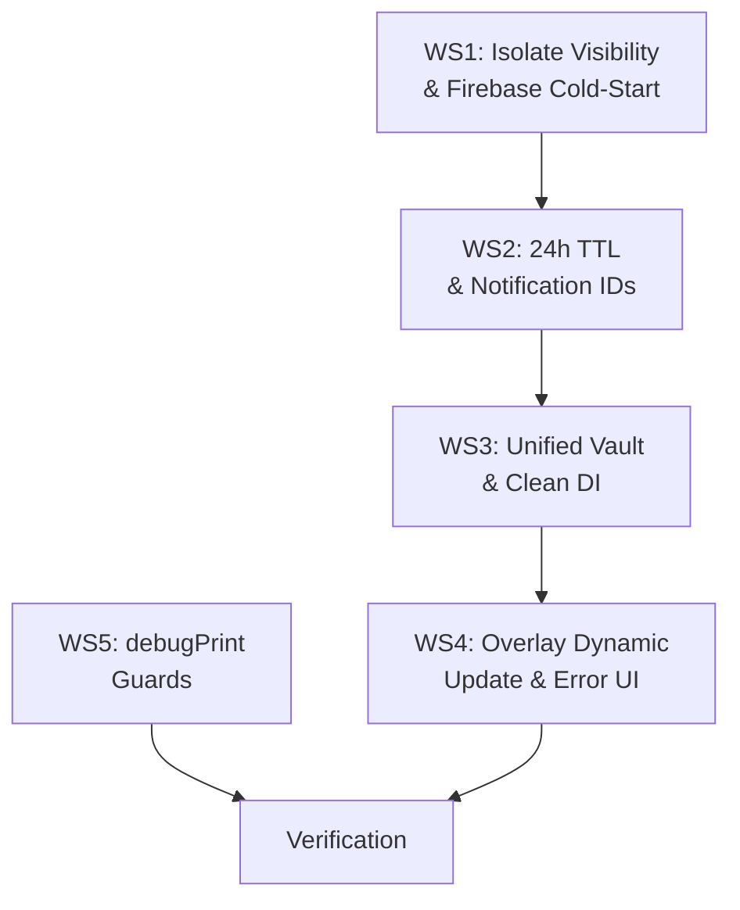

# Phase 8.1 — Background Services Master Remediation

Remediation of 5 critical architectural flaws in the background SMS processing, overlay, and isolate subsystems as defined in [Master_Fix_Blueprint.md](file:///c:/src/walletmanager/Master_Fix_Blueprint.md).

---

## User Review Required

> [!IMPORTANT]
> **Subscription TTL Notification Text**: The blueprint specifies Arabic-only notification text for the stale-sync notification. Should we also add an English variant and use the device locale, or keep it Arabic-only as specified?

> [!WARNING]
> **`OverlayRepository` Removal**: The current `OverlayRepository` is a thin wrapper around a direct `SharedPreferences` call using the orphan key `pending_overlay_tx`. The plan proposes **deleting this class entirely** and migrating its single consumer (`OverlayUseCase`) to use `LocalStorageService.saveToVault()` instead. This will also affect `GlobalOverlayListener` which reads from the same orphan key. Please confirm this is acceptable.

> [!IMPORTANT]
> **`_onIosBackground` Visibility**: This `@pragma('vm:entry-point')` function is currently private (`_onIosBackground`). The blueprint mandates all pragmatized functions be public. However, since iOS is not the target platform, making it public is low-risk but technically broadens the API surface. The plan includes this change for consistency.

---

## Open Questions

1. **`GlobalOverlayListener` direct `SharedPreferences` access** — This widget also calls `SharedPreferences.getInstance()` directly (line 56). Should we refactor it to accept `LocalStorageService` via constructor injection (widget-level DI), or is the current approach acceptable since it runs in the main isolate where the singleton is already initialized?

2. **`LocalizationProvider` direct `SharedPreferences` access** — Same pattern at lines 16 and 27. Should we refactor this provider to use `LocalStorageService` for consistency, or leave it as-is since it only manages locale strings?

---

## Proposed Changes

### Workstream 1: Isolate Visibility & Firebase Cold-Start (C-1, C-2, M-1, Q-1)

**Goal**: Prevent tree-shaking of background callbacks and fix cold-start Crashlytics crashes.

#### [MODIFY] [background_service.dart](file:///c:/src/walletmanager/lib/core/services/background_service.dart)

1. **Rename `_backgroundSmsCallback` → `backgroundSmsCallback`** (line 99)
   - Remove the leading underscore to make it a public top-level function
   - Update the reference on line 87 (`onBackgroundMessage: backgroundSmsCallback`)

2. **Rename `_onIosBackground` → `onIosBackground`** (line 49)
   - Same rationale — private `@pragma` entrypoints can be tree-shaken

3. **Add safe Firebase initialization** inside `backgroundSmsCallback`, BEFORE the try/catch:
   ```dart
   if (Firebase.apps.isEmpty) {
     await Firebase.initializeApp();
   }
   ```

4. **Replace `debugPrint` in catch block** (line 114) with `AppErrorHandler.logSilentError(...)`:
   ```dart
   } catch (e, stack) {
     AppErrorHandler.logSilentError(
       e.toString(),
       'backgroundSmsCallback',
       stackTrace: stack,
     );
   }
   ```
   This ensures errors reach Crashlytics in release builds (Firebase will now be initialized above).

5. **Add required imports**: `firebase_core`, `app_error_handler.dart`

---

### Workstream 2: 24h Subscription TTL & Unique Notification IDs (M-3, Q-3)

**Goal**: Block background SMS processing when subscription data is >24h stale; stack notifications instead of replacing them.

#### [MODIFY] [local_storage_service.dart](file:///c:/src/walletmanager/lib/data/services/local_storage_service.dart)

Add a new key and accessors for the subscription sync timestamp:

```dart
static const String _kSubLastSyncMs = 'sub_last_sync_ms';

Future<void> saveSubLastSyncMs() async {
  _ensureInitialized();
  await _prefs!.setInt(_kSubLastSyncMs, DateTime.now().millisecondsSinceEpoch);
}

int? get subLastSyncMs => _prefs?.getInt(_kSubLastSyncMs);

/// Returns true if the subscription data was synced within the last 24 hours.
bool get isSubscriptionSyncFresh {
  final lastSync = subLastSyncMs;
  if (lastSync == null) return false;
  final elapsed = DateTime.now().millisecondsSinceEpoch - lastSync;
  return elapsed < const Duration(hours: 24).inMilliseconds;
}
```

#### [MODIFY] [subscription_provider.dart](file:///c:/src/walletmanager/lib/providers/subscription_provider.dart)

In `_syncToStorage()` (line 167), **also persist the sync timestamp**:
```dart
void _syncToStorage() {
  final sub = _subscription;
  if (sub != null) {
    LocalStorageService.instance.saveSubscriptionLimits(
      endDateMs: sub.endDate?.millisecondsSinceEpoch,
      isLifetime: sub.planId == SubscriptionPlan.lifetime,
      smsEnabled: sub.smsEnabled,
      isSuspended: sub.status == SubscriptionStatus.suspended,
    );
    LocalStorageService.instance.saveSubLastSyncMs(); // ← NEW
  }
}
```

#### [MODIFY] [sms_processing_pipeline.dart](file:///c:/src/walletmanager/lib/core/services/sms_processing_pipeline.dart)

1. **Add 24h TTL guard** after the existing subscription checks (~line 112), before parsing:
   ```dart
   // Guard: 24h Subscription Sync Staleness
   if (!storage.isSubscriptionSyncFresh) {
     await _showStaleSyncNotification();
     return;
   }
   ```

2. **Add `_showStaleSyncNotification()` method**:
   ```dart
   Future<void> _showStaleSyncNotification() async {
     await _ensureNotificationsInitialized();
     const AndroidNotificationDetails androidDetails = AndroidNotificationDetails(
       _kChannelId,
       _kChannelName,
       channelDescription: _kChannelDesc,
       importance: Importance.max,
       priority: Priority.high,
       autoCancel: true,
     );
     const NotificationDetails details = NotificationDetails(android: androidDetails);
     await _notificationsPlugin.show(
       8888, // Dedicated ID for stale-sync notification
       '⚠️ تنبيه مزامنة',
       'انتهت صلاحية مزامنة الاشتراك. يرجى فتح التطبيق لتحديث بياناتك.',
       details,
     );
   }
   ```

3. **Unique Notification IDs** in `_showWakeUpNotification` (line 86):
   Replace `0` with a hash derived from the amount and current timestamp:
   ```dart
   final int notificationId = (DateTime.now().millisecondsSinceEpoch % 100000).hashCode.abs() % 99999;
   await _notificationsPlugin.show(
     notificationId,
     ...
   );
   ```

---

### Workstream 3: Unified Vault & Clean DI (C-6, Q-2)

**Goal**: Eliminate data fragmentation between `pending_overlay_data` and `pending_overlay_tx` keys; route all SharedPreferences access through `LocalStorageService`.

#### [MODIFY] [overlay_repository.dart](file:///c:/src/walletmanager/lib/data/repositories/overlay_repository.dart)

Refactor to use `LocalStorageService` instead of direct `SharedPreferences.getInstance()`:

```dart
import 'package:walletmanager/data/services/local_storage_service.dart';

class OverlayRepository {
  final LocalStorageService _storage;

  OverlayRepository({LocalStorageService? storage})
      : _storage = storage ?? LocalStorageService.instance;

  Future<void> savePendingTransaction(Map<String, dynamic> txData) async {
    await _storage.saveToVault(txData);
  }
}
```

This eliminates the orphan `pending_overlay_tx` key and unifies all overlay data under the single `pending_overlay_data` key managed by `LocalStorageService.saveToVault()`.

#### [MODIFY] [service_locator.dart](file:///c:/src/walletmanager/lib/core/di/service_locator.dart)

Update the `OverlayRepository` registration to inject `LocalStorageService`:

```dart
sl.registerLazySingleton<OverlayRepository>(
  () => OverlayRepository(storage: sl<LocalStorageService>()),
);
```

#### [MODIFY] [global_overlay_listener.dart](file:///c:/src/walletmanager/lib/core/widgets/global_overlay_listener.dart)

Migrate from orphan key `pending_overlay_tx` → `LocalStorageService`:

1. Replace `SharedPreferences.getInstance()` (line 56) with `LocalStorageService.instance`
2. Replace `prefs.getString('pending_overlay_tx')` (line 59) with `storage.readFromVault()`
3. Replace `prefs.remove('pending_overlay_tx')` (line 103) with `storage.clearVault()`
4. Remove `import 'package:shared_preferences/shared_preferences.dart'`

```dart
Future<void> _fetchAndApplyData() async {
  try {
    final storage = LocalStorageService.instance;
    await storage.reloadDisk();

    final data = storage.readFromVault();
    if (data == null) return;

    if (mounted) {
      // ... existing logic using `data` ...
    }

    await storage.clearVault();
  } catch (e) {
    debugPrint('⚠️ [GlobalOverlayListener] _fetchAndApplyData error: $e');
  }
}
```

---

### Workstream 4: Overlay Dynamic Update & Graceful Failure (M-2, C-5)

**Goal**: Avoid close/reopen overlay churn; show error UI if overlay init fails.

#### [MODIFY] [sms_processing_pipeline.dart](file:///c:/src/walletmanager/lib/core/services/sms_processing_pipeline.dart)

Replace the close-then-reopen logic (lines 224-226) with dynamic update:

```dart
// ── Trigger Overlay ─────────────────────────────────────
final bool isGranted = await FlutterOverlayWindow.isPermissionGranted();
if (!isGranted) return;

if (await FlutterOverlayWindow.isActive()) {
  // Dynamic update: push new data to the existing overlay
  await FlutterOverlayWindow.shareData(overlayArgs);
} else {
  await FlutterOverlayWindow.showOverlay(
    enableDrag: true,
    overlayTitle: 'New Transaction',
    overlayContent: 'Amount: ${dto.amount} EGP',
    flag: OverlayFlag.focusPointer,
    alignment: OverlayAlignment.center,
    visibility: NotificationVisibility.visibilityPublic,
    positionGravity: PositionGravity.auto,
    height: WindowSize.matchParent,
    width: WindowSize.matchParent,
    startPosition: const OverlayPosition(0, 0),
  );
  await FlutterOverlayWindow.shareData(overlayArgs);
}
```

Remove the now-redundant `shareData` call that was after line 242 (it's now inside both branches).

#### [MODIFY] [main.dart](file:///c:/src/walletmanager/lib/main.dart)

Wrap the **entire** `overlayMain` initialization in a try-catch so that if `setupServiceLocator()` also throws, it's caught:

```dart
@pragma("vm:entry-point")
void overlayMain() async {
  WidgetsFlutterBinding.ensureInitialized();

  try {
    await Firebase.initializeApp();
    await setupServiceLocator();
    runApp(const TransactionOverlayApp());
  } catch (e) {
    if (kDebugMode) {
      debugPrint("❌ Overlay init error: $e");
    }
    runApp(const OverlayErrorApp());
  }
}
```

Update `OverlayFirebaseFailsafeApp` → rename to `OverlayErrorApp` and update the body text to the Arabic string from the blueprint:

```
❌ خطأ في الاتصال. يرجى إتمام المعاملة من التطبيق الأساسي.
```

---

### Workstream 5: Permissions & debugPrint Tech Debt (C-4, M-5, Q-4)

**Goal**: Ensure zero permission requests from background isolates; guard all `debugPrint` in background code paths with `kDebugMode`.

#### [VERIFY] [background_service.dart](file:///c:/src/walletmanager/lib/core/services/background_service.dart)

✅ **Already clean** — No `Permission` import or request found. All `debugPrint` calls on lines 75, 108, 114 are already guarded by `if (kDebugMode)`.

#### [VERIFY] [sms_service.dart](file:///c:/src/walletmanager/lib/core/services/sms_service.dart)

✅ **Already correct** — `Permission.ignoreBatteryOptimizations` and `Permission.notification` are only requested in the `init()` method which runs in the main UI isolate.

#### [MODIFY] [wallet_provider.dart](file:///c:/src/walletmanager/lib/providers/wallet_provider.dart)

Guard **all unguarded `debugPrint`** calls with `if (kDebugMode)`:

| Line(s) | Current | Status |
|---------|---------|--------|
| 105, 128 | `debugPrint('🔥 [TX_FLOW]...')` | ⚠️ **Unguarded** — wrap in `if (kDebugMode)` |
| 150 | `debugPrint('🔥 [TX_FLOW] LOCAL MUTATION...')` | ⚠️ **Unguarded** |
| 171 | `debugPrint('🔥 [TX_FLOW] LOCAL MUTATION APPLIED!')` | ⚠️ **Unguarded** |
| 236, 238, 242, 251, 258, 270, 281, 282 | `debugPrint(...)` | ⚠️ **Unguarded** |

All 12 unguarded `debugPrint` calls will be wrapped in `if (kDebugMode) { ... }`.

---

## Summary of Files Changed

| File | Action | Workstream |
|------|--------|------------|
| [background_service.dart](file:///c:/src/walletmanager/lib/core/services/background_service.dart) | MODIFY | WS1 |
| [sms_processing_pipeline.dart](file:///c:/src/walletmanager/lib/core/services/sms_processing_pipeline.dart) | MODIFY | WS2, WS4 |
| [local_storage_service.dart](file:///c:/src/walletmanager/lib/data/services/local_storage_service.dart) | MODIFY | WS2 |
| [subscription_provider.dart](file:///c:/src/walletmanager/lib/providers/subscription_provider.dart) | MODIFY | WS2 |
| [overlay_repository.dart](file:///c:/src/walletmanager/lib/data/repositories/overlay_repository.dart) | MODIFY | WS3 |
| [service_locator.dart](file:///c:/src/walletmanager/lib/core/di/service_locator.dart) | MODIFY | WS3 |
| [global_overlay_listener.dart](file:///c:/src/walletmanager/lib/core/widgets/global_overlay_listener.dart) | MODIFY | WS3 |
| [main.dart](file:///c:/src/walletmanager/lib/main.dart) | MODIFY | WS4 |
| [wallet_provider.dart](file:///c:/src/walletmanager/lib/providers/wallet_provider.dart) | MODIFY | WS5 |

---

## Execution Order

The workstreams have dependencies and should be executed in this order:



- **WS1 first**: Firebase init must be established in the cold-start isolate before WS2's TTL check can use `AppErrorHandler` reliably.
- **WS2 before WS3**: The TTL adds new `LocalStorageService` methods that WS3's unified vault depends on being stable.
- **WS3 before WS4**: The overlay dynamic update (WS4) reads from the vault, so the vault must be unified first.
- **WS5 is independent** and can be done in parallel at any point.

---

## Verification Plan

### Static Analysis
```bash
flutter analyze
dart format . --set-exit-if-changed
```

### Automated Tests
- Run existing test suite: `flutter test`
- Verify no regressions in `test/providers/wallet_provider_test.dart`
- Verify `OverlayRepository` tests (if any) still pass after DI refactor
- Verify `subscription_provider_test.dart` covers sync-to-storage

### Manual Verification
- **WS1**: Build release APK, kill app, send test SMS → verify no crash, verify Crashlytics receives event
- **WS2**: Set device clock >24h ahead without opening app → verify SMS processing is blocked and stale-sync notification appears
- **WS3**: Trigger SMS → verify overlay reads data correctly from the unified vault key
- **WS4**: Send two rapid SMS → verify overlay updates in-place without close/reopen flicker
- **WS5**: Build release APK → verify zero `debugPrint` output in logcat

### Acceptance Criteria Checklist
- [ ] `@pragma` background callbacks are strictly public
- [ ] Firebase is explicitly initialized in the cold-start isolate before Crashlytics usage
- [ ] Background SMS pipeline is blocked if subscription data is > 24 hours stale
- [ ] `LocalStorageService` is strictly used for the overlay vault with a single, unified key
- [ ] Active overlays are dynamically updated via `shareData()` instead of being closed and reopened
- [ ] Overlay initialization failures result in a dedicated Error UI, not a crash
- [ ] Zero permissions are requested from background isolates
- [ ] All `debugPrint` statements in background paths are guarded by `kDebugMode`
