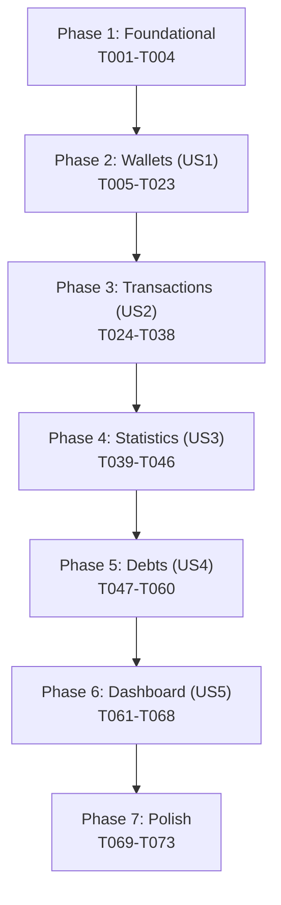

# Task Breakdown: Surgical Reactivity Architecture Refactor

**Feature**: State Management & UI Reactivity Refactoring
**Spec**: `specs/002-surgical-reactivity-refactor/spec.md`
**Plan**: `specs/002-surgical-reactivity-refactor/plan.md`

---

## User Stories → Task Mapping

| Story | Description | Scenarios | Priority |
|-------|-------------|-----------|----------|
| US1 | Wallets Domain — Provider O(1) maps, fetch shield, rollback + UI Selectors | S2, S3, S7, S8 | P1 |
| US2 | Transactions Domain — Provider O(1) maps, fetch shield, pre-compute + UI Selectors | S1, S4, S7, S8 | P1 |
| US3 | Statistics Domain — Pre-computed data, fetch shield + UI Selectors | S6 | P2 |
| US4 | Debts Domain — Provider O(1) maps, fetch shield, rollback + UI Selectors | S5, S7 | P2 |
| US5 | Dashboard — Remove root context.watch, add scoped Selectors per section | S1 | P3 |

---

## Phase 1: Foundational

- [x] T001 Verify existing Provider singleton registration order in `lib/main.dart` to confirm no re-registration conflicts before refactoring begins
- [x] T002 Add `dart:async` import (for `Timer`) to `lib/providers/wallet_provider.dart` if not already present
- [x] T003 Add `dart:async` import (for `Timer`) to `lib/providers/transaction_provider.dart` if not already present
- [x] T004 Add `dart:async` import (for `Timer`) to `lib/providers/debt_provider.dart` if not already present

---

## Phase 2: Wallets Domain (US1)

**Story Goal**: Wallet Provider exposes O(1) indexed `walletMap`, enforces 5s fetch shield, implements snapshot rollback on all mutations. Wallet UI screens use `Selector` instead of root `Consumer`/`context.watch`, and `WalletDetailsScreen` reads from Provider RAM (no `StreamBuilder`).

**Independent Test Criteria**:
- `flutter analyze` passes with zero errors
- `WalletProvider.walletMap` returns wallet by ID in O(1)
- `WalletDetailsScreen` has zero `StreamBuilder` widgets
- `WalletsListScreen` has zero root-level `Consumer` or `context.watch`
- `AddBalanceScreen` stores only wallet ID, not full `WalletModel` snapshot

### Phase 2A — WalletProvider

- [x] T005 [US1] Add `Map<String, WalletModel> _walletMap = {}` field and `walletMap` getter to `lib/providers/wallet_provider.dart`
- [x] T006 [US1] Add private `_rebuildWalletMap()` helper method that builds `_walletMap` from `_wallets` list in `lib/providers/wallet_provider.dart`
- [x] T007 [US1] Call `_rebuildWalletMap()` at the end of `fetchInitialWallets()` after `_wallets` assignment in `lib/providers/wallet_provider.dart`
- [x] T008 [US1] Call `_rebuildWalletMap()` at the end of `fetchMoreWallets()` after `_wallets.addAll()` in `lib/providers/wallet_provider.dart`
- [x] T009 [US1] Upgrade fetch shield: rename `_lockFetching` to `_fetchShieldActive`, add `Timer? _fetchShieldTimer` field and `_activateFetchShield()` method with 5-second duration in `lib/providers/wallet_provider.dart`
- [x] T010 [US1] Replace all `_lockFetching` references with `_fetchShieldActive` and call `_activateFetchShield()` in `applyLocalDeduction()`, overlay `local_deduct` handler, and `updateWalletOptimistically()` in `lib/providers/wallet_provider.dart`
- [x] T011 [US1] Guard `fetchInitialWallets()` and `fetchMoreWallets()` with early return if `_fetchShieldActive` is true in `lib/providers/wallet_provider.dart`
- [x] T012 [US1] Refactor `createWallet()` with optimistic add to `_wallets` + `_walletMap` + `notifyListeners()` before Firestore write, wrapped in try-catch with rollback in `lib/providers/wallet_provider.dart`
- [x] T013 [US1] Refactor `addBalanceToWallet()` with snapshot of previous balance, optimistic update to `_wallets` + `_walletMap` + `notifyListeners()`, try-catch with balance revert rollback in `lib/providers/wallet_provider.dart`
- [x] T014 [US1] Refactor `deleteWallet()` with snapshot of removed wallet, optimistic remove from `_wallets` + `_walletMap` + `notifyListeners()`, try-catch with re-insertion rollback in `lib/providers/wallet_provider.dart`
- [x] T015 [US1] Refactor `updateWallet()` with snapshot of previous wallet state, optimistic apply to `_wallets` + `_walletMap` + `notifyListeners()`, try-catch with revert rollback in `lib/providers/wallet_provider.dart`
- [x] T016 [US1] Sync `_walletMap` in `applyLocalDeduction()` and overlay `local_deduct` handler after wallet mutation in `lib/providers/wallet_provider.dart`
- [x] T017 [US1] Cancel `_fetchShieldTimer` in `dispose()` method of `lib/providers/wallet_provider.dart`
- [x] T018 [US1] Run `flutter analyze` and verify zero errors after WalletProvider refactor

### Phase 2B — Wallets UI

- [x] T019 [US1] Remove `StreamBuilder<WalletModel?>` from `WalletDetailsScreen` body and replace with `Selector<WalletProvider, WalletModel?>` reading from `walletMap[walletId]` in `lib/presentation/screens/wallets/wallet_details_screen.dart`
- [x] T020 [US1] Replace root `Consumer<WalletProvider>` with scoped `Selector<WalletProvider, List<WalletModel>>` for list body, `Selector<WalletProvider, WalletStatusState>` for loading states, and `Selector<WalletProvider, bool>` for `hasMore` in `lib/presentation/screens/wallets/wallets_list_screen.dart`
- [x] T021 [US1] Verify composite `ValueKey('${wallet.walletId}_${wallet.balance}')` is present on wallet list items in `lib/presentation/screens/wallets/wallets_list_screen.dart` — already confirmed ✅
- [x] T022 [US1] Refactor `AddBalanceScreen`: replace `WalletModel? _selectedWallet` with `String? _selectedWalletId`, use `Selector<WalletProvider, WalletModel?>` reading from `walletMap[_selectedWalletId]` for live balance display in `lib/presentation/screens/wallets/add_balance_screen.dart`
- [x] T023 [US1] Run `flutter analyze` and verify zero errors after Wallets UI refactor

---

## Phase 3: Transactions Domain (US2)

**Story Goal**: Transaction Provider exposes O(1) indexed `transactionMap`, pre-computes `todayTransactions`, enforces 5s fetch shield, and skips redundant `onTransactionsChanged` fetches. Transaction UI screens use `Selector` and composite `ValueKey`. Transaction and create screens use O(1) `walletMap` lookups.

**Independent Test Criteria**:
- `flutter analyze` passes with zero errors
- `TransactionProvider.transactionMap` returns transaction by ID in O(1)
- `TransactionProvider.todayTransactions` is pre-computed (no filtering in `build()`)
- `TodayTransactionsScreen` has zero root-level `Consumer` or `context.watch`
- `TransactionDetailsScreen` uses `walletMap[id]` instead of `firstWhereOrNull`
- `CreateTransactionScreen` stores only wallet ID, not full snapshot

### Phase 3A — TransactionProvider

- [x] T024 [US2] Add `Map<String, TransactionModel> _transactionMap = {}` field and `transactionMap` getter to `lib/providers/transaction_provider.dart`
- [x] T025 [US2] Add private `_rebuildTransactionMap()` helper that builds `_transactionMap` from `_transactions` list in `lib/providers/transaction_provider.dart`
- [x] T026 [US2] Call `_rebuildTransactionMap()` after every `_transactions` mutation: `fetchInitialTransactions()`, `fetchMoreTransactions()`, `insertTransactionLocally()` in `lib/providers/transaction_provider.dart`
- [x] T027 [US2] Add fetch shield: `Timer? _fetchShieldTimer`, `bool _fetchShieldActive`, `_activateFetchShield()` method with 5s duration in `lib/providers/transaction_provider.dart`
- [x] T028 [US2] Guard `fetchInitialTransactions()` with early return if `_fetchShieldActive` is true; activate shield in `insertTransactionLocally()` in `lib/providers/transaction_provider.dart`
- [x] T029 [US2] Refactor `appEvents.onTransactionsChanged` listener to skip `fetchInitialTransactions()` call — local state is already updated by mutating method — in `lib/providers/transaction_provider.dart`
- [x] T030 [US2] Add pre-computed `List<TransactionModel> _todayTransactions = []` field with public getter and private `_recomputeTodayTransactions()` method; call after every `_transactions` mutation in `lib/providers/transaction_provider.dart`
- [x] T031 [US2] Cancel `_fetchShieldTimer` in `dispose()` method of `lib/providers/transaction_provider.dart`
- [x] T032 [US2] Run `flutter analyze` and verify zero errors after TransactionProvider refactor

### Phase 3B — Transactions UI

- [x] T033 [US2] Replace root `Consumer<TransactionProvider>` with `Selector<TransactionProvider, List<TransactionModel>>` for transaction list and `Selector<TransactionProvider, TransactionStatus>` for loading states in `lib/presentation/screens/transactions/today_transactions_screen.dart`
- [x] T034 [US2] Add composite `ValueKey('${tx.transactionId}_${tx.amount}_${tx.paymentStatus}')` on transaction list items in `lib/presentation/screens/transactions/today_transactions_screen.dart`
- [x] T035 [US2] Replace `walletProvider.wallets.firstWhereOrNull(...)` with `walletProvider.walletMap[transaction.walletId]` and replace `Consumer<WalletProvider>` with `Selector<WalletProvider, WalletModel?>` in `_buildWalletInfoCard` in `lib/presentation/screens/transactions/transaction_details_screen.dart`
- [x] T036 [US2] Replace `firstWhere` lookup at line 72 with `walletProvider.walletMap[_preSelectedWalletId]` in `lib/presentation/screens/transactions/create_transaction_screen.dart`
- [x] T037 [US2] Refactor `CreateTransactionScreen`: replace `WalletModel? _selectedWallet` with `String? _selectedWalletId`, use `Selector<WalletProvider, WalletModel?>` for live balance display in `lib/presentation/screens/transactions/create_transaction_screen.dart`
- [x] T038 [US2] Run `flutter analyze` and verify zero errors after Transactions UI refactor

---

## Phase 4: Statistics Domain (US3)

**Story Goal**: Statistics Provider pre-computes all derived data so zero computation occurs in `build()`, enforces fetch shield. Statistics UI uses `Selector` instead of root `Consumer`.

**Independent Test Criteria**:
- `flutter analyze` passes with zero errors
- `StatisticsProvider` exposes ready-to-consume summary properties
- `GeneralStatisticsScreen` has zero root-level `Consumer` or `context.watch`

### Phase 4A — StatisticsProvider

- [x] T039 [US3] Verify that `dashboardSummary` and `filteredStats` are fully pre-computed before exposure; refactor any on-demand computation into cached fields updated upon state change in `lib/providers/statistics_provider.dart`
- [x] T040 [US3] Add fetch shield: `Timer? _fetchShieldTimer`, `bool _fetchShieldActive`, `_activateFetchShield()` method with 5s duration in `lib/providers/statistics_provider.dart`
- [x] T041 [US3] Guard `fetchStatistics()` with early return if `_fetchShieldActive` is true in `lib/providers/statistics_provider.dart`
- [x] T042 [US3] Verify `addTransactionOptimistically()` properly updates pre-computed summary fields in `lib/providers/statistics_provider.dart`
- [x] T043 [US3] Cancel `_fetchShieldTimer` in `dispose()` method of `lib/providers/statistics_provider.dart`
- [x] T044 [US3] Run `flutter analyze` and verify zero errors after StatisticsProvider refactor

### Phase 4B — Statistics UI

- [x] T045 [US3] Replace root `Consumer<StatisticsProvider>` with `Selector<StatisticsProvider, StatsMode>` for mode switching, `Selector<StatisticsProvider, StatsSummaryModel?>` for summary display, and `Selector<StatisticsProvider, bool>` for loading state in `lib/presentation/screens/statistics/general_statistics_screen.dart`
- [x] T046 [US3] Run `flutter analyze` and verify zero errors after Statistics UI refactor

---

## Phase 5: Debts Domain (US4)

**Story Goal**: Debt Provider exposes O(1) indexed `debtMap`, enforces 5s fetch shield, implements snapshot rollback on all mutations. Debts UI uses `Selector` and composite `ValueKey`.

**Independent Test Criteria**:
- `flutter analyze` passes with zero errors
- `DebtProvider.debtMap` returns debt by ID in O(1)
- `DebtsListScreen` has zero root-level `Consumer` or `context.watch`
- `DebtsListScreen` uses composite `ValueKey('${debt.debtId}_${debt.amountDue}_${debt.debtStatus}')`

### Phase 5A — DebtProvider
- [x] T047 [US4] Add `Map<String, DebtModel> _debtMap = {}` field and `debtMap` getter to `lib/providers/debt_provider.dart`
- [x] T048 [US4] Add private `_rebuildDebtMap()` helper that builds `_debtMap` from `_debts` list in `lib/providers/debt_provider.dart`
- [x] T049 [US4] Call `_rebuildDebtMap()` after every `_debts` mutation: `fetchDebts()`, `fetchMoreDebts()`, `createDebt()`, `updateDebt()`, `markDebtAsPaid()`, `deleteDebt()` in `lib/providers/debt_provider.dart`
- [x] T050 [US4] Add fetch shield: `Timer? _fetchShieldTimer`, `bool _fetchShieldActive`, `_activateFetchShield()` method with 5s duration in `lib/providers/debt_provider.dart`
- [x] T051 [US4] Guard `fetchDebts()` with early return if `_fetchShieldActive` is true in `lib/providers/debt_provider.dart`
- [x] T052 [US4] Refactor `appEvents.onDebtsChanged` listener to skip redundant `fetchDebts()` call in `lib/providers/debt_provider.dart`
- [x] T053 [US4] Refactor `createDebt()` with optimistic add + `_rebuildDebtMap()` + `notifyListeners()` before Firestore write, try-catch with rollback in `lib/providers/debt_provider.dart`
- [x] T054 [US4] Refactor `updateDebt()` with snapshot + optimistic update + `_rebuildDebtMap()` + `notifyListeners()`, try-catch with revert rollback in `lib/providers/debt_provider.dart`
- [x] T055 [US4] Refactor `markDebtAsPaid()` with snapshot + optimistic status change + `_rebuildDebtMap()` + `notifyListeners()`, try-catch with revert rollback in `lib/providers/debt_provider.dart`
- [x] T056 [US4] Cancel `_fetchShieldTimer` in `dispose()` method of `lib/providers/debt_provider.dart`
- [x] T057 [US4] Run `flutter analyze` and verify zero errors after DebtProvider refactor

### Phase 5B — Debts UI
- [x] T058 [US4] Replace root `Consumer<DebtProvider>` with scoped Selectors for debt list, loading states, and filter mode in `lib/presentation/screens/debts/debts_list_screen.dart`
- [x] T059 [US4] Fix `ValueKey(debt.debtId)` to composite `ValueKey('${debt.debtId}_${debt.amountDue}_${debt.debtStatus}')` on debt list items in `lib/presentation/screens/debts/debts_list_screen.dart`
- [x] T060 [US4] Run `flutter analyze` and verify zero errors after Debts UI refactor

---

## Phase 6: Dashboard Cross-Domain (US5)

**Story Goal**: Remove all 5 root-level `context.watch` calls from `MainDashboardScreen` and replace with 6+ scoped `Selector` widgets — one per independent dashboard section.

**Independent Test Criteria**:
- `flutter analyze` passes with zero errors
- `MainDashboardScreen` has zero `context.watch<T>()` calls
- Each dashboard section (greeting, balance, wallets, transactions, stats, debts) rebuilds independently

- [x] T061 [US5] Extract greeting text section into `Selector<AuthProvider, String?>` that selects `currentUser?.name` in `lib/presentation/screens/home/main_dashboard_screen.dart`
- [x] T062 [US5] Extract balance summary card into `Selector<WalletProvider, double>` that selects sum of wallet balances in `lib/presentation/screens/home/main_dashboard_screen.dart`
- [x] T063 [US5] Extract wallets horizontal list into `Selector<WalletProvider, List<WalletModel>>` in `lib/presentation/screens/home/main_dashboard_screen.dart`
- [x] T064 [US5] Extract today's transactions section into `Selector<TransactionProvider, List<TransactionModel>>` selecting `todayTransactions` in `lib/presentation/screens/home/main_dashboard_screen.dart`
- [x] T065 [US5] Extract statistics summary section into `Selector<StatisticsProvider, StatsSummaryModel?>` in `lib/presentation/screens/home/main_dashboard_screen.dart`
- [x] T066 [US5] Extract debts alert section into `Selector<DebtProvider, int>` selecting open debts count in `lib/presentation/screens/home/main_dashboard_screen.dart`
- [x] T067 [US5] Remove all 5 `context.watch<T>()` calls (lines 94-98) — replace any remaining non-Selector usages with `context.read<T>()` for one-shot access in `lib/presentation/screens/home/main_dashboard_screen.dart`
- [x] T068 [US5] Run `flutter analyze` and verify zero errors after Dashboard refactor

---

## Phase 7: Polish & Cross-Cutting Concerns

- [x] T069 Run final `flutter analyze` — verify zero errors across entire codebase
- [x] T070 Grep audit: `grep -r "context.watch" lib/presentation/screens/` — confirm only justified usages remain (auth/login screens)
- [x] T071 Grep audit: `grep -r "StreamBuilder" lib/presentation/screens/` — confirm zero instances for Provider-managed data
- [x] T072 Grep audit: `grep -r "firstWhere\|firstWhereOrNull" lib/presentation/screens/` — confirm zero instances in `build()` methods
- [x] T073 Verify composite `ValueKey` on all mutable list items across wallets, transactions, and debts screens

---

## Dependencies

**Hard Dependencies**:
- Phase 2 (Wallets) must complete before Phase 3 (Transactions) — `TransactionDetailsScreen` and `CreateTransactionScreen` depend on `walletMap` from `WalletProvider`
- Phase 6 (Dashboard) requires ALL provider phases (2-5) complete — Dashboard Selectors reference `walletMap`, `todayTransactions`, `dashboardSummary`, and `debtMap`

**Within-Phase Parallelism**:
- Phase 2A tasks T005-T017 are sequential (all modify `wallet_provider.dart`)
- Phase 2B tasks T019, T020, T022 are parallelizable ([P]) — they modify different files
- Phase 3B tasks T033, T035, T036 are parallelizable ([P]) — they modify different files
- Phase 5B tasks T058, T059 target the same file — sequential
- Phase 6 tasks T061-T067 all target `main_dashboard_screen.dart` — sequential

---

## Implementation Strategy

1. **MVP Scope**: Phase 1 (Foundational) + Phase 2 (Wallets US1) — delivers the highest-value refactor (StreamBuilder removal, O(1) maps, fetch shield) for the most-used domain
2. **Incremental Delivery**: Each phase produces a stable, analyzable checkpoint
3. **No Big Bang**: Never modify more than one Provider in a single commit
4. **Validation Gate**: `flutter analyze` must pass at every phase boundary before proceeding
